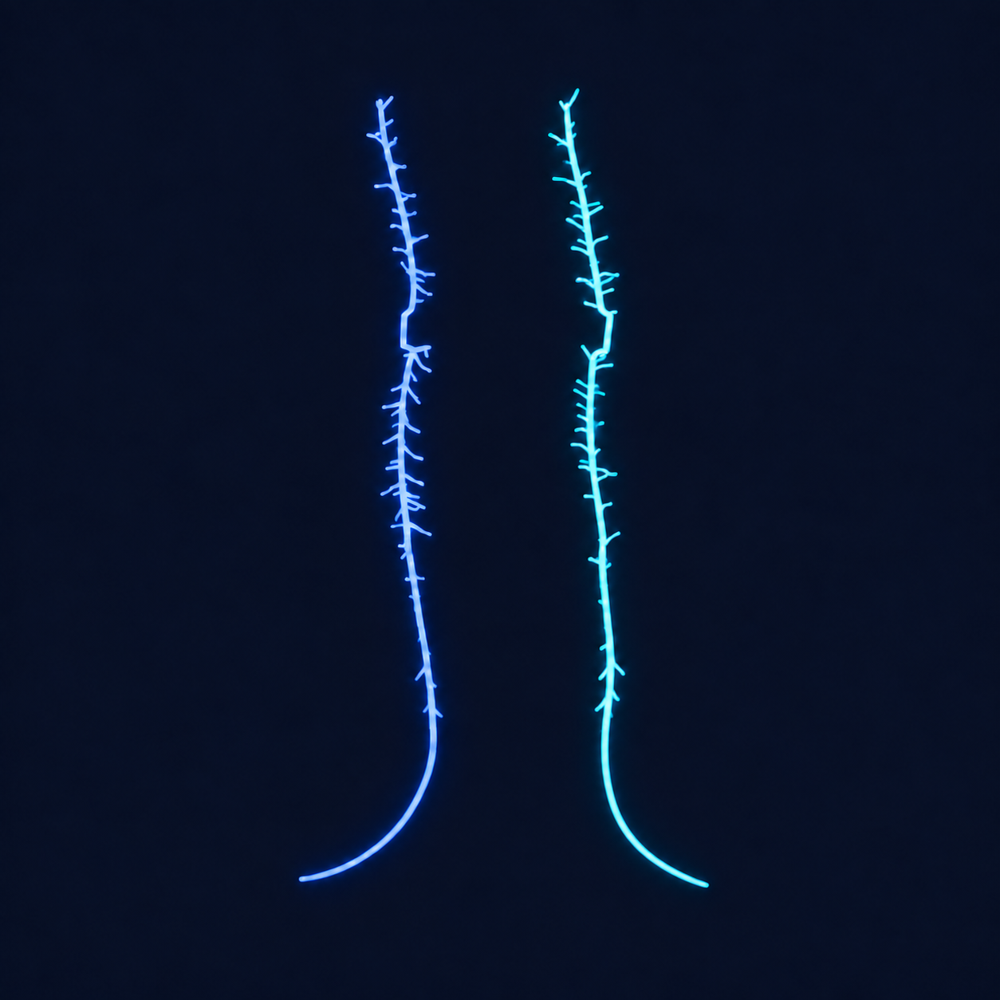

# Digifly Workstation

<p align="center">
  
</p>

Digifly Workstation is a desktop app for building Drosophila neural circuits from
connectome data and running electrophysiology experiments. It supports neuPrint
downloads, membrane and connection editing, and analysis of voltage propagation,
spike events and recorded currents.

[Download 0.2.2 for macOS or Windows](https://github.com/Saint-Sam/Digifly-Application/releases/tag/v0.2.2)

## Install

- **macOS:** Apple silicon, macOS 14 or later. Digifly Workstation runs from the
  extracted `macOS-arm64` ZIP. Current builds are ad-hoc signed; Developer ID
  signing and notarization are pending.
- **Windows:** `Digifly Workstation.exe` runs from the extracted
  `Windows-x86_64` ZIP, with the accompanying files in the same folder.
  An offline NEURON installation is included; setup requires confirmation.

The app includes its interface runtime. On Mac, **Workspace** supports an
existing NEURON installation or a new installation through runtime setup.

## First experiment

The **First experiment** tutorial covers a Male CNS v1.0 circuit with DNp01,
TTMn, PSI and DLMn, from neuron downloads and NEURON setup through SWC repairs
and the first run.

The main pages follow the same workflow:

1. **Data Library:** SWC and connectivity downloads are organized by connectome
   and release. neuPrint access uses an account token. Local SWC folders can be
   linked, and suggested morphology repairs are reviewed before a copy is saved.
2. **Circuit Builder:** Neuron selection and skeleton views accompany membrane,
   channel and connection settings. Changes can apply to the circuit, individual
   neurons or selected compartments.
3. **Experiment Builder:** Simulator, stimulus, condition and recording controls
   define each experiment. Readiness checks identify settings that prevent a run.
4. **Results:** Saved experiments include traces and replay. **Morphology voltage**
   displays measured voltages on the skeleton. **All compartments** recording
   captures propagation along the full skeleton; soma-only recordings color the
   recorded soma edges.

## Data and saved experiments

Digifly stores neuron files, simulator installations and experiment results
outside the application. Each connectome release has an SWC library organized by
family, type and neuron ID. Existing neurons are replaced only after confirmation.
Links to SWC folders elsewhere on the device are saved between sessions.

Connectivity tables are stored by connectome and release. The Windows package
includes a MANC v1.2.1 connectivity table in Parquet format. Neuron skeletons and
individual synapse locations are downloaded separately.

Saved runs contain the circuit, experiment settings and recordings. Traces and
voltage replay are available in **Results**.

## Current support

This is alpha software. The [bug and fix log](docs/BUG_FIX_LOG.md) records known
issues and repairs; the [student-readiness review](docs/STUDENT_READINESS_MAC_20261028.md)
tracks controls still awaiting tests.

Windows package checks on Server 2022 cover NEURON installation, a small
experiment, saved Results and updater recovery. Windows 11 testing is still
pending.

Arbor and BMTK BioNet support selected channel and connection models. The app
checks settings before Run; BioNet electrical connections currently use serial
execution. The [channel execution record](docs/CHANNEL_EXECUTION_REPAIR.md)
documents supported settings and simulator comparisons. The older 49-cell
Escape-SIZ comparison has an unresolved voltage mismatch.

## Coming soon

Planned additions:

- Custom ion-channel downloads and installation from Channelpedia and ModelDB in Circuit Builder.
- Leaky integrate-and-fire models, with point-neuron and compartment-based options.
- Additional simulators, including Brian2.

## Development

Development requires Python 3.11 or later. Setup and launch commands:

```bash
./scripts/setup_dev.sh
./scripts/run_dev.sh
```

[Contributing](CONTRIBUTING.md) covers tests,
[Architecture](docs/ARCHITECTURE.md) describes the code structure, and
[Packaging](docs/PACKAGING_BOUNDARY.md) documents distribution requirements.

## License

Digifly's original code, documentation and interface assets use the
[MIT License](LICENSE). Third-party software, models and datasets retain their
own licenses, listed in [Third-party notices](THIRD_PARTY_NOTICES.md).
