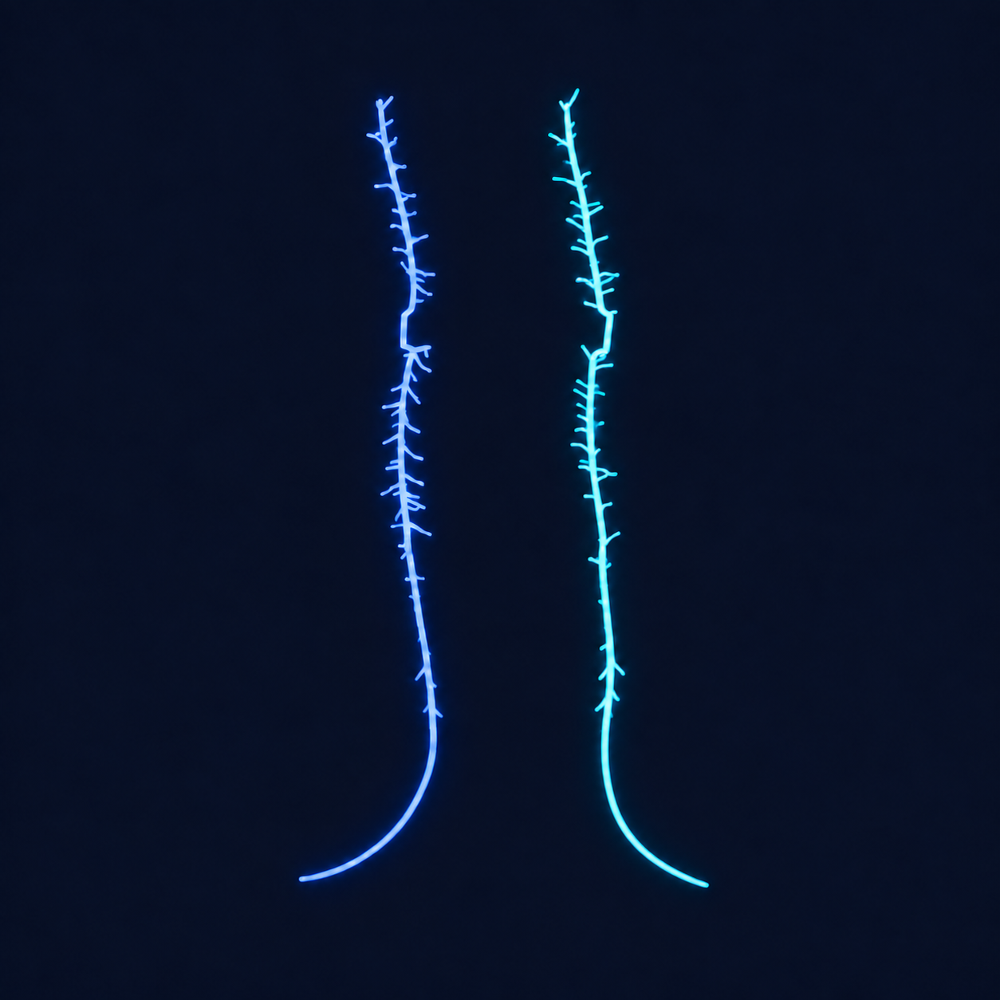

# Digifly Workstation

  

Digifly Workstation is a desktop app for loading neuron morphologies, configuring
circuits and experiments, and reviewing simulation results. The current source
includes the shared SWC-library, neuron-list download and updater repairs.

## Mac and Windows downloads

Use the [release page](https://github.com/Saint-Sam/Digifly-Application/releases/tag/v0.1.0-alpha.1)
for packaged applications. Prefer explicitly versioned downloads; historical
and rollback assets remain available for recovery.

The October 19 packages are being finalized. The source on this branch includes
the latest repairs; a successful build is not automatically a published download.
Release notes identify the exact build and checks for each platform.

- **Mac:** Apple silicon, macOS 14 or newer. Local tester builds are ad-hoc
  signed, not Apple-notarized. Intel Mac packages are not currently supplied.
- **Windows:** x86-64. The current edition includes an official NEURON installer
  and a private offline runtime setup path. Existing simulator installations
  are not replaced. Arbor is deferred for this Windows edition.
- Scientific runtimes, downloaded SWCs, saved projects and run results remain
  separate from the app. The Windows edition includes only the explicitly
  selected, checksum-pinned MANC connectivity Parquet; it contains no SWCs.

## Recent improvements

- A growing SWC library for each exact server and dataset release, with
  `export_swc/family/type/body-ID/` folders shared by individual and list searches.
- Literal neuron-name/ID lists such as `DNp01, TTMn, PSI`, with per-name match
  counts and a preview before downloading.
- Existing-neuron checks and explicit Keep/Replace choices, preserving previous
  files when a replacement is requested.
- Clear download destinations and plain-language download details.
- Data Library support for saved NEURON, Arbor, BioNet and NetPyNE settings.
- Verified update downloads, Install and Restart, saved-draft recovery and
  restoration after early startup failure.
- Post-success cleanup of exact, unchanged updater-owned obsolete files.
  Saved projects, SWCs, installed simulators and run data are protected.
- Build-number checks that reject older downloads and disable automatic
  replacement when the installed version cannot be verified.

## Modeling and results

Circuit Builder separates morphology, connectivity and membrane settings from
Experiment Builder's stimulation, recording and execution settings. Supported
paths include NEURON, Arbor and BMTK BioNet; each requested feature is checked
against the selected engine's implemented capabilities before execution.
Unsupported settings must be reported, not silently approximated.

NetPyNE and independently authored BioNet replication tools are included in the
source. Their presence does not mean every paper claim or figure is accepted.
BioNet and NetPyNE share NEURON and are not independent-solver replications.
Run-specific scientific evidence and limitations remain separate from app
installation tests.

See [architecture](docs/ARCHITECTURE.md),
[packaging boundaries](docs/PACKAGING_BOUNDARY.md),
[Windows testing](docs/WINDOWS_TESTER.md) and
[updater checks](docs/UPDATER_REPAIR_20261017_V1.md).

## Source development

Use the setup scripts for your platform, then run `main.py` from the configured
development environment. Packaged apps include their own interface runtime;
ordinary users do not need to build the source to use a release.

## License

Digifly-authored code is [MIT licensed](LICENSE). Third-party software, channel
mechanisms and datasets retain their own terms and attribution; see
[third-party materials](THIRD_PARTY_NOTICES.md). Application test results are
engineering evidence, not scientific or legal certification.
