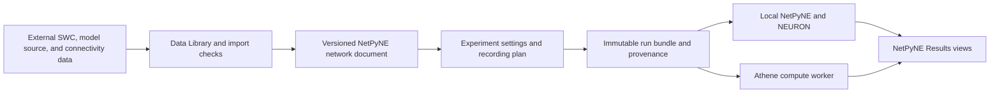

# NetPyNE Workbench in Digifly

_Architecture and delivery contract · 2026-09-23_

## Goal and boundary

Digifly should let a user assemble, inspect, run, and analyze a NetPyNE model without editing Python for ordinary settings. The PDCM paper replication is the first end-to-end test, not the limit of the workbench. Digifly will own the saved model document, experiment settings, run provenance, and Results views; NetPyNE/NEURON remains the simulation engine. Large morphology and connectivity datasets remain external to the app package and are referenced through the Data Library.

The dedicated NetPyNE tab now has a pinned PDCM reference lane and a separate editable version-1 synthetic model lane. The reference lane verifies the exact author source, previews its eight populations, E/I effects, scaled counts, and connection-probability matrix, then runs one condition from source/name/scale/duration/drive/seed. The editable lane covers single-soma HH cells, populations, Exp2Syn mechanisms, probabilistic/convergent/divergent connections, NetStim input, duration/integration/seeds, and spike/soma-voltage recording. It saves a validated versioned JSON document, exports NetPyNE settings, and runs locally in a chosen NetPyNE/NEURON interpreter. A six-cell E/I run completed through the actual app controls; Results loaded 42 spikes and six voltage traces. Results also has an interactive population-filtered, time-windowed raster backed by the original CSV. This does **not** yet edit the authors' PDCM rules, import arbitrary SWCs/connectivity as executable model inputs, provide LFP/CSD analysis, run a paper condition batch, or submit an Athene job from the desktop UI.

## What the model document must express

The general NetPyNE document must be distinct from Digifly's existing finite-SWC `CircuitSpec`. NetPyNE models need cell rules (point cells or morphology-bearing cells), populations, synaptic mechanisms, rule-based or explicit connections, and stimulation sources and targets. The simulation configuration must separately retain duration, integration step, random seeds, recordings, and requested analyses. Each external file receives a path or resolvable resource identifier, format, origin, and checksum; no SWC or large connectome is silently copied into the application bundle.[^1]

Connectivity cannot be reduced to a green/red E/I label. The editor should show the biological phenotype **and** the executable synaptic mechanism, weight or weight distribution, delay, target section/location, and reversal or inhibitory effect where applicable. Rule cards need pre/post selectors and exactly one primary targeting method—probability, convergence, divergence, or explicit connection list—with a preview of expected edge count. Imported explicit edges must retain source IDs and validation results. The SWC quality/healing workflow already in Digifly should run before a morphology is admitted as an editable cell rule; NetPyNE's own SWC import does not validate the morphology.[^1][^2]

The PDCM reference source stays **read-only and hash-locked**. Digifly may display its cells, populations, connections, and drives, and may vary the condition parameters the paper actually varies. Editing network rules requires “Clone to editable model,” producing a clearly labeled derivative that cannot be mistaken for a paper reproduction. Figures 1–9 use the point-neuron model and do not need imported SWCs; Figure 10 uses the authors' separate multicompartment branch and must have its own morphology/mechanism intake.[^3]

## UI shape

Use a dedicated **NetPyNE Workbench** entry with focused subviews rather than many unrelated top-level tabs:

| View | Controls and visual feedback | Save/validation contract |
| --- | --- | --- |
| Model sources | Choose pinned author model or an editable project; link SWC, cell templates, and connectivity files from Data Library; show source/license/hash and import warnings | Never edit source files in place; report missing files and morphology checks |
| Network Builder | Cell rules and morphology, populations, synaptic mechanisms, connectivity and edge-sign/effect, external inputs; network/3D preview | Save a versioned declarative model; preflight invalid selectors, missing mechanisms, unrealistic edge counts |
| Experiment Builder | NetPyNE engine, duration/dt, seeds, stimulus schedule, recording sites, spikes/traces/LFP electrodes, run name/output folder, local runtime | Save experiment separately from network; show predicted resources and exact generated run settings |
| Run and Results | Progress and logs; interactive spike raster/histogram/population rates, network positions/convergence, traces, and LFP/CSD/spectrum when recorded | Window/downsample large event sets without discarding raw artifacts; preserve filters, exports, and provenance |

The existing Circuit Builder viewport, Data Library, experiment identity, and Results artifact controls can be reused, but their current SWC-centric data structure must not be presented as a complete NetPyNE model. Display only analyses for data that were actually recorded; for example, do not offer LFP or CSD for a point-neuron run without those signals.[^1][^4]

## Incremental delivery

1. **PDCM round-trip in the app.** Add a NetPyNE/PDCM entry point with named paper-condition presets and clear locked-source status. Make source/runtime preflight, 100 ms settling, drive/scale/seed, run progress, and loading of spike raster and paper-timed tables visible. Confirm a local 1% run launched from the UI matches the existing CLI contract. Athene can remain a separate compute submission path for now.
2. **Versioned NetPyNE backend.** Define a `NetworkModelSpec` and an `ExperimentSpec` with schema migration, explicit external resource references, import validation, deterministic NetParams/SimConfig export, and a save/load/execute round trip. A small synthetic two-population network is the golden test; no large datasets belong in tests or packages.
3. **Network Builder.** Build cells/morphology, populations, synapses/connectivity, and input panels on that validated schema. Include E/I phenotype plus actual executable effect, estimated counts, and visual previews. First support pinned/native NetPyNE constructs and SWC; add SONATA, NeuroML2, and other converters only as separately tested adapters.[^5]
4. **NetPyNE Results.** Add scalable interactive spikes, population statistics, network structure, and recorded signals. Use raw event files for exact analysis and view-window/downsample for rendering. The paper's figure matrix becomes a separate comparison/plotting layer; an attractive raster alone is not an accepted replication.
5. **Replication and sweeps.** Add condition batches, seeds, parameter sweeps, and figure-by-figure acceptance. Preserve native NetPyNE outputs as the reference before Arbor/BMTK translations. The PDCM Figure 9 structural/spectral lane and Figure 10 multicompartment/LFP lane remain distinct.[^3][^6]

The first increment should **not** promise arbitrary imported network editing or all ten figures. It is complete when a user can choose the pinned PDCM source and runtime in the app, run a 1% paper-timed condition, inspect interactive spike/rate results, and reopen the saved run with all expected artifacts and provenance intact. General NetPyNE authoring follows behind the versioned backend, so UI controls never outpace executable semantics.

## References

[^1]: NetPyNE. [Model specification](https://doc.netpyne.org/modeling-specification-v1.0.html) and [user documentation](https://doc.netpyne.org/user_documentation.html).
[^2]: NetPyNE. [Cell import and conversion API](https://doc.netpyne.org/netpyne.conversion.html).
[^3]: Digifly. [PDCM paper replication contract](PDCM_REPLICATION.md).
[^4]: NetPyNE. [Plotting API](https://doc.netpyne.org/netpyne.plotting.html) and [raster plotting](https://doc.netpyne.org/netpyne.plotting.plotRaster.html).
[^5]: NetPyNE. [Conversion API](https://doc.netpyne.org/netpyne.conversion.html).
[^6]: NetPyNE. [Batch simulation tutorial](https://doc.netpyne.org/tutorial.html#tutorial-8-running-batch-simulations).
