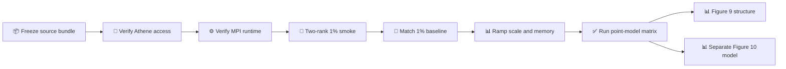

# PDCM replication on FAU Athene

_Staged execution contract for the Romaro et al. (2021) whole-paper replication · 2026-09-23_

---

## 🎯 Scope and current status

Athene is the intended high-memory CPU venue for the full-size NetPyNE reference runs; it is not a substitute for reproducing the authors' conditions, analyses, or figures. The existing local 1%/60.1 s balanced-Poisson run is a validation point, not a paper reproduction. As of 2026-09-23, dedicated-key access, the two-rank NEURON probe, and isolated NetPyNE import passed. A two-rank 1%/200 ms smoke test (Slurm `4732536`) and a two-rank 1%/60.1 s balanced-Poisson run (`4732541`) both completed with exit code 0. Their Results artifacts were checksum-verified into the persistent Digifly run root. See [the figure acceptance matrix](PDCM_REPLICATION.md) for the still-incomplete scientific target.

## 🔐 Access and storage

Use the Florida Atlantic University Athene host `athene-login.hpc.fau.edu`, not the similarly named German NHR@FAU Helma cluster. FAU documents both SSH and OnDemand access; the user can enroll a dedicated public key through OnDemand, keeping the private key on the Mac.[^1] Do not paste a password or MFA code into Digifly, a repository, a run manifest, or a chat transcript. Verify `hostname`, `id -un`, `sinfo`, `squeue -u "$USER"`, and the current home/scratch quota after login. The July 2026 local probe is historical, not a live capacity guarantee.

FAU lists `shortq7` at six hours, `mediumq7` at 72 hours, and `longq7` at seven days; select the queue from the *current* allocation policy and a measured runtime estimate rather than copying the authors' cluster-specific 16-node script.[^2] FAU's storage documentation says scratch is unbacked and files older than 90 days may be removed, so every accepted result must be checksum-verified back into Digifly's persistent run root before relying on it.[^3]

## 📦 Prepare and stage one run

`digifly-replicate-pdcm --prepare-only` creates a named, relocatable bundle with the exact authors' point-model source, the small documented NumPy compatibility patch, a request, and SHA-256 manifests. The prepared bundle should be transferred to a *new* Athene scratch directory. Verify hashes at both ends and never overwrite an existing local or remote run. The model source and run bundle are separate from any connectome/SWC dataset; none of the MANC or male-CNS data belongs in this transfer.

The cluster runner is [`scripts/run_pdcm_athene.sh`](../scripts/run_pdcm_athene.sh). It deliberately does not choose a partition, rank count, walltime, or memory budget. A Slurm allocation and an explicit MPI-enabled NetPyNE/NEURON runtime must already exist. On a compute node it compiles `IntFire_PD.mod` once, then starts the separate MPI worker with Athene's OpenMPI `mpiexec`; it records the compiler and MPI logs in the run bundle. Direct `srun` failed for this installed OpenMPI because the build lacks Slurm PMI support; a two-rank `mpiexec` NEURON-only probe passed under Slurm as job `4732503` on 2026-09-23. It retains a one-time claim marker so failed bundles are investigated and preserved rather than silently resubmitted under the same name. Neither the macOS app's bundled Arbor interpreter nor the published Docker simulator image is evidence of an Athene-compatible MPI NEURON build.

[`scripts/probe_neuron_mpi.py`](../scripts/probe_neuron_mpi.py) is the model-free rank diagnostic. [`scripts/install_pdcm_athene_layer.sh`](../scripts/install_pdcm_athene_layer.sh) installs NetPyNE into a *new* scratch-only package layer from a Slurm compute allocation; it refuses an existing target and does not modify the working NEURON environment. The validated layer is `/mnt/onefs/scratch/juanlopez2016/digifly_pdcm_env/netpyne111-nrn827-py312-20260923` (NetPyNE 1.1.1, NEURON 8.2.7+, Python 3.12.4). Its install job `4732509` passed imports, and the two model runs named above subsequently passed with this layer. The runner selects it explicitly through `DIGIFLY_PDCM_LAYER`; the completed 60.1 s run retains its `digifly_layer_manifest.json`, exact worker, Slurm script, and logs under `provenance/`.

Before submission, verify that the selected `python`, `nrniv`, and `nrnivmodl` use a compatible NetPyNE layer and NEURON environment, that `nrniv -mpi` runs with the cluster's MPI implementation, and that the staged standalone MPI worker matches the local version. Once the layer is installed, only the prepared run, worker, and job wrapper need transfer for another model attempt; the full Digifly source tree and large datasets do not. Record the exact runtime/layer manifest, source commit, job ID, allocation, walltime, peak memory, stdout/stderr, and output hashes. Do not run scientific computation on the login node.[^4]

## 🧪 Scale-up gates

| Gate | Run | Pass condition |
| --- | --- | --- |
| 0 | Read-only Athene inspection | Account, quota, partitions, and available MPI runtime confirmed |
| 1 | 1% point model, short duration, two ranks | All eight populations present; unique cell/spike IDs; one rank-0 Results summary; no truncated files |
| 2 | 1% balanced Poisson, 60.1 s, two ranks | Paper-timed outputs and local single-process population rates agree under declared tolerance |
| 3 | 3%, then 10% and 30% short runs | Measured contacts, per-rank peak memory, and walltime support a defensible larger allocation |
| 4 | Full point-model condition matrix | Full-scale and 50/30/10/1% conditions complete, with matching analysis windows and seeds |
| 5 | Figure 9 structural lane | 10%/4 s connection convergence exported before connection data is discarded; spectral and Granger analysis separately verified |
| 6 | Figure 10 multicompartment lane | Separate pinned source branch and mechanisms; voltage, LFP, CSD, and 3D outputs independently validated |

No gate may be called complete merely because Slurm reports `COMPLETED`. Check the run manifest, all expected artifacts, hashes, cell counts, numerical metrics, and any simulation warnings. A failure keeps its logs and claim marker; any retry gets a fresh run name. Use `squeue` and `sacct` before submission to prevent duplicate active jobs.[^5]

The first model job (`4732519`) exposed an import-order error before simulation. A separate retry (`4732527`) completed the numerical model and wrote Results, but Slurm marked it failed because the embedded Python exited before NEURON finalized MPI. Those failed bundles remain untouched on scratch. The corrected 200 ms job (`4732536`) passed in 26 s: 767 cortical cells, 458 spikes, both rank shards intact, and all required numerical acceptance checks true. The 60.1 s job (`4732541`) passed in 2 min 29 s with 767 cells and 139,724 spikes; its ten listed Results artifacts all load locally. These are 1% validation runs, not completed paper figures or an estimate of full-scale resource use.

Short, two-rank scale pilots then measured the pinned source's actual network growth. Peak resident memory is reported per process by the MPI worker, before rank-zero output aggregation; it is not a whole-job high-water mark.

| Scale and duration | Slurm job | Cortical cells | Recurrent contacts | Peak resident memory per rank | Elapsed |
| --- | --- | ---: | ---: | ---: | ---: |
| 3%, 200 ms | `4732555` | 2,311 | 268,793 | 308 MiB | 51 s |
| 10%, 200 ms | `4732560` | 7,713 | 2,987,541 | 1,211 MiB | 5 min 14 s |

Both pilot Results folders were copied into the persistent Digifly workspace, checksum-compared with scratch, and loaded with all listed artifacts present. The paper describes **more than 30 million synapses** for its 10% Figure 9 example, while this pinned source generated about **3 million recurrent contacts** at 10%. The source/definition difference remains unresolved; these 200 ms pilots are not Figure 9 and do not include its convergence, spectral, or Granger outputs. The measured memory and time do not justify extrapolating linearly to full scale.

## 📥 Retrieve and compare

Transfer completed outputs into a new local `runs/experiments` directory, verify each file against a recorded SHA-256 list before marking it usable, and keep the original cluster log and job metadata. Digifly Results may load the run's summary and artifacts; figure generation and paper-matched comparisons can remain separate scripts. Figure 9's connectivity outputs and Figure 10's multicompartment outputs must not be mislabeled as products of the existing point-neuron worker. Arbor and BMTK ports start only after this native NetPyNE baseline is measured; they are cross-engine tests, not replacements for it.

## 🔗 References

[^1]: FAU Research Computing. “Accessing Athene” and “How to ssh to Athene using Mac/Linux.” https://helpdesk.fau.edu/TDClient/2061/Portal/KB/Article/141467/Accessing-Athene and https://helpdesk.fau.edu/TDClient/2061/Portal/KB/PrintArticle?ID=142038
[^2]: FAU Research Computing. “Athene Slurm Partitions.” https://helpdesk.fau.edu/TDClient/2061/Portal/KB/PrintArticle?ID=141348
[^3]: FAU Research Computing. “Research Computing Storage.” https://helpdesk.fau.edu/TDClient/2061/Portal/KB/Article/145079/Research-Computing-Storage
[^4]: FAU Research Computing. “Submitting Jobs on Athene using Slurm.” https://helpdesk.fau.edu/TDClient/2061/Portal/KB/Article/141472/Submitting-Jobs-on-Athene-using-Slurm-salloc-srun-sbatch-sinfo-squeue
[^5]: FAU Research Computing. “Viewing Job and Node Information with Slurm.” https://helpdesk.fau.edu/TDClient/2061/Portal/KB/PrintArticle?ID=141354
