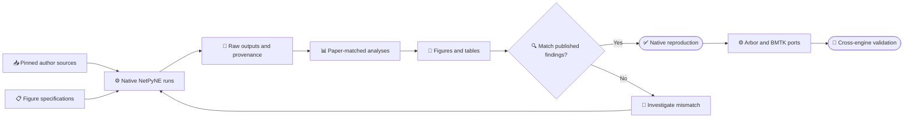

# PDCM paper replication in Digifly

_Scope and acceptance record for reproducing Romaro et al. (2021), including every main figure and the numerical supplements._

---

## 🎯 Definition of complete

The target is the *whole paper*, not one raster or one small test run. A complete native NetPyNE reproduction requires the authors' point-neuron and multicompartment models, every condition and scale used in Figures 1–10, a source-checked Table 1 scaling-method audit, the relevant Tables 2–3 and Supplementary Tables S1–S8, and independently regenerated figure panels. Digifly must launch and retain the model runs and their provenance; a separate, versioned analysis/plotting program may generate the final figures. **Scientific replication means reproducibility of prespecified outcomes across independent network realizations, not identical cells, pixels, or traces.** Numerical analyses must use defensible recording windows and explicit feasible neuron sampling; an unpublished exact sample is not required if outcome robustness is tested. A simulation merely finishing, or one seed resembling a panel, is not a scientific pass. The [outcome-replication protocol](PDCM_STATISTICAL_REPLICATION_PROTOCOL.md) separates condition completion, statistical outcome replication, and optional author-method identity.[^1]



## 📋 Figure-by-figure contract

The following conditions and panels come from the paper's methods and captions. The status column records *verified Digifly work*, not an intention.[^1]

| Paper output | Required run and analysis | Current status |
| --- | --- | --- |
| Figure 1 | Full-size balanced Poisson; 500 ms raster of 1,862 cells; 60 s population firing rate and CV ISI; 5 s, 3 ms-bin synchrony with paper sampling; original NEST reference stars in B–D | Guarded renderer ready; full-scale run and sourced NEST stars absent |
| Figure 2 | Full-size balanced Poisson; all 77,169 neurons in raster and statistics to expose sampling-dependent synchrony | Guarded renderer ready; full-scale run absent |
| Figure 3 | Full-size balanced DC in A/B and unbalanced Poisson in C/D; 1,862-cell rasters, 60 s DC rates, and 1 s unbalanced Poisson rates, with original NEST reference stars | Guarded renderer ready; both full-scale conditions and sourced NEST stars absent |
| Figure 4 | 50% scale; balanced Poisson and balanced DC; raster, firing rate, CV ISI, synchrony | Both 60.1 s jobs technically accepted and paired eight-panel Digifly reconstruction rendered; quantitative/visual paper-panel acceptance and independent-network robustness remain |
| Figure 5 | 30% scale; same two drives and four measures as Figure 4 | Both 60.1 s jobs `4732770`/`4732769` verified; eight-panel paired Digifly reconstruction rendered with a recorded 1,862-cell raster sample; partial numerical comparison completed, visual/panel acceptance pending |
| Figure 6 | 10% scale; same two drives and four measures as Figure 4 | Eight-panel Digifly reconstruction rendered from both 60 s drives; single-seed outcome checks remain provisional. Exact paper sample IDs are unnecessary for outcome replication, but its stated 8,000 unique-cell sample is infeasible at this scale, so sampling sensitivity must be reported |
| Figure 7 | 30% scale; Poisson and DC; all 23,147 neurons included without subsampling | Both runs verified and explicit all-cell sidecars completed; eight-panel paired Digifly reconstruction rendered; qualitative sampling comparison completed, panel acceptance pending |
| Figure 8 | Scaling series for Poisson and DC; 60 s firing rate, CV ISI and synchrony, plus 5 s cross-correlation as the fourth panel for each drive | Version-12 eight-panel native audit has 17/19 paper-active conditions measured, adding technically accepted 80% DC `4749319`. Only both 100% drives remain missing. BioNet companion v4 separately has 2/19 app-origin observations. Short pilots are capacity-only, not paper points. Signed-equation versus absolute-table correlation, mixed runtimes and independent-network robustness remain unresolved |
| Figure 9 | 10% scale, 4 s; top/side cell locations, connection convergence, spike-rate spectrogram, spectral Granger causality | Dedicated job `4732881` verified; A–E rendered from the same 4,000 ms run. Gamma directionality appears in one seed under two mean-handling methods. A source-count audit finds the saved ~2.99-million recurrent entries match the authors' quadratic scaling rule, while the paper's >30-million prose remains discordant; independent-seed repeatability remains untested |
| Figure 10 | Authors' `multicompartment` branch, 1% scale, 600 ms; 3D voltage view, raster, traces, rates, LFP at 15 depths, CSD, LFP spectrogram and power spectrum | TH-off and TH-on 1%/600 ms source-defined candidates now have integrated A–H sheets; proof-of-concept outcomes need independent-seed robustness, while TH/morphology/CSD interpretation stays conditional |
| Table 1; Tables 2–3 and S1–S8 | Source-audited scaling rule; multi-seed full-size rate comparison; sampling-dependent synchrony; and all per-scale/per-drive rate, CV, synchrony and cross-correlation data | Table 1 source rule audited below; Tables 2–3 not run; supplementary grid incomplete |

The paper specifies a 100 ms settling period. It uses 60 s for mean firing rate and CV ISI; usually 5 s for synchrony and cross-correlation, except Table 3 and Figure 8, which use 60 s for synchrony. Synchrony uses 3 ms bins and cross-correlation uses 25 ms bins. The number of sampled cells changes the synchrony result substantially, so the sample IDs and sampling rule must be stored with every derived result.[^1]

Two of the paper's sampling descriptions are impossible as unique-cell selections. Its Table 3 labels one row as 2,000 cells per population although full-scale L5i has only 1,065 cells. At 10% scale, the whole model has 7,713 cells, so an 8,000-cell sample for Figure 6 cannot consist of distinct neurons. Digifly records its honest capped sample of 5,015 cells for that run; it does not silently sample with replacement or call it the paper's exact 8,000-cell selection. Figure 7 instead requires all 23,147 cells at 30% scale, with 5 s synchrony rather than the present worker's capped 1,000-per-population analysis.[^1]

The supplementary tables give the Figure 8 Poisson scale grid as **100, 80, 60, 50, 40, 30, 20, 10, 5, 2, and 1%**. Their DC tables stop at **10%**, yielding **19 paper-active scale/drive conditions**, not a full 22-condition Cartesian product. The paper explicitly reports no firing with DC input below 10%; those three smaller DC scales are an exploratory edge-case grid, not missing active paper data. Its prose describing a range from 90% to 1% is inconsistent with the tabulated Poisson grid. The main figures additionally require unbalanced Poisson at full scale and analyses with different sampling rules.[^1][^5]

### Table 1 scaling-rule audit

The pinned authors' `netParams.py` implements the operations behind the paper's Table 1. This is a **source audit**, not a numerical replication of the remaining figure and table outputs.[^1][^2]

| Table 1 operation | Pinned executable rule | Audit result |
| --- | --- | --- |
| Cortical population size | `int(k * N_i)` for each of eight populations | Matches the stated `kN` rule up to integer truncation |
| Recurrent connectivity | Each presynaptic divergence is multiplied by `k` while the presynaptic population also shrinks by `k` | Expected total recurrent connection count follows approximately `k²`, not an exact count after integer and random sampling |
| Poisson background input | Each target's paired `NetStim` rate is `k * I_i * f_ext` | Implements the stated `kI` external-input rule |
| Synaptic weight | Base `w_p` is divided by `sqrt(k)` when `k < 1` | Implements the inverse-square-root compensation; cell-type-specific inhibitory and L4e→L2/3e factors remain applied |
| Compensating current | Adds `(1 - sqrt(k))` times the source-estimated recurrent and external mean-current terms | Restores mean input approximately using the pinned `F_out` constants; it is not recomputed from each run's observed firing rates |

The executable scaling path also applies integer truncation to population sizes and samples weights and delays, so identical Table 1 algebra does not imply an identical instantiated network or a fixed `k²` connection count at any one seed. The authors' source, rather than a simplified restatement of the table, remains the executable reference.[^1][^2]

An explicit [Figure 8 partial-condition renderer](../scripts/render_pdcm_figure8_partial.py) has produced a versioned local audit under `outputs/pdcm/figure8-partial-available-v5/`. Its seven paper-active conditions are balanced Poisson at 1%, 2%, 5%, 10%, and 30%, and balanced DC at 10% and 30%; the remaining 12 active slots are gray gaps, not zeros or interpolated values. The new 5% Poisson run completed 60.1 s locally with 3,854 cortical cells and 817,111 cortical spikes; its source-locked summary and cell/spike row counts agree, and a separate version-2 sidecar records the 100–60,100 ms rate/CV/synchrony and 100–5,100 ms correlation windows. A separate 1% DC run completed 60.1 s with 767 cortical cells and seven initialization spikes, all before the 100 ms settling cutoff; its 60 s rates are correctly zero while CV, synchrony, and correlation are undefined. The paper predicts this below-10% DC silence, so the audit marks it as measured but outside the active paper grid. The 300 DPI PNG, vector PDF, 176-row source CSV, caption and hash manifest preserve the single-seed provenance. Rate/CV and synchrony use 60 s. The fourth row corresponds to the paper's Figure 8D/H cross-correlation panels and uses the specified 5 s window; filled circles show absolute and crosses signed values because the printed equation and published table disagree. Those two marks are **alternative, unresolved interpretations**, not two paper curves. The local 1%, 2%, and 5% runs used NetPyNE 1.1.1/NEURON 9.0.1, whereas larger Athene runs used a different NEURON version. This is **not** the paper's complete Figure 8 and does not resolve the source-versus-paper metric discrepancy.[^1]

For the new 5% Poisson run, the measured 60 s rates differ by at most 0.71% from the seven reliably readable population-rate entries in the authors' preprint Supplementary Table S1. The extracted L6i reference repeats the L6e value despite the other columns and local result differing, so it is excluded pending visual verification of the original table. This is a useful single-seed rate check, not Figure 8 acceptance: cross-correlation semantics, sampling identity, CV, synchrony, and the remaining scales still require their own checks.[^5]

A separate, non-destructive [small-scale Figure 8 reference audit](../scripts/audit_pdcm_figure8_small_scales.py) now checks the completed 1%, 2%, and 5% balanced-Poisson points against author-preprint Tables S1, S3, and S5. Its versioned sidecar is `outputs/pdcm/figure8-small-scales-reference-audit-v1/`, with 72 comparison rows, 69 usable numeric cells, input/output hashes, and explicit sampling caveats. Across the eight populations where a numeric reference is reliable, the largest absolute differences are 2.84% for 1% rates, 3.62% for 2% CV ISI, and 8.15% for 1% 60 s Fano synchrony; the full per-scale/per-metric table is in the sidecar. The three L6i rate cells are excluded because the available PDF extraction repeats L6e. These are comparisons to rounded, single-seed *preprint* values, not the verified final journal supplement, exact sample IDs, cross-correlation, or Figure 8 acceptance. The active condition grid remains 7/19 measured. Nine focused Figure 8 tests pass, and no source run or earlier figure was altered.[^1][^5]

The version-1 seed-cohort inventory is superseded by the non-destructive [version-2 audit](../scripts/audit_pdcm_seed_cohorts.py) at `outputs/pdcm/figure8-seed-cohort-audit-v2/`. It hash-checks the Figure 8 manifest inputs, completed runs, paper-window analyses, and eight population rows per run; its 19-condition inventory and 64 population-metric rows cover eight available runs, including one measured-silent 1% DC run outside the active paper grid. Of the 19 active conditions, **7 are measured, 12 are absent, and none has multiple independent network realizations**. The original `seed` changed stimulus and analysis sampling but left the network streams fixed, so a different stimulus seed alone no longer counts as a new network; future runs count separately only with an explicit `network_seed` and verified `conn`/`loc`/`cell`/`m`/`stim` streams. Two simulator environments remain across the active grid, so cross-scale differences are runtime-confounded until tested under overlapping or consistent environments. The v2 audit does not pool different source/runtime environments or claim scientific acceptance, and it neither launched nor modified a simulation. Fourteen focused seed-audit and seed-derivation tests pass; the older v1 files remain preserved for provenance.[^1]

The later [version-6 Figure 8 audit](../outputs/pdcm/figure8-partial-available-v6/figure_manifest.json) adds the accepted 20% balanced-Poisson run as a new measured point. It contains **8 of 19 paper-required conditions** and retains 11 explicit gaps; the 1% DC silent control remains exploratory. The 300 DPI PNG, vector PDF, source-data CSV, caption, and manifest output hashes were verified after rendering. Its companion [version-3 seed-cohort audit](../outputs/pdcm/figure8-seed-cohort-audit-v3/audit_manifest.json) hash-checks nine included runs, 19 inventory conditions and 72 population-metric rows. None has multiple independent network realizations, and cross-scale simulator environments remain mixed. These are still single-seed partial reconstructions, not a reproduced paper outcome.[^1]

## 🧪 Current implementation and validation

Digifly has an initial, version-locked native NetPyNE lane for the authors' point-neuron `master` model. Workspace can identify a NetPyNE/NEURON Python, the dedicated NetPyNE tab can launch one condition and inspect the pinned source's population/connectivity constants, and Results can browse its raw spikes interactively with population filters and time zoom. Model code is copied into a named run folder without altering the user's source, and hashes plus compatibility changes are recorded. The source model is not bundled with Digifly. A 1% balanced-Poisson run completed 60.1 s total (100 ms settling plus 60 s analyzed), producing 767 cortical cells and 141,541 cortical spikes. The current worker exports cell positions, sampled IDs, 60 s firing rate/CV ISI, 5 s and 60 s synchrony, and 5 s cross-correlation using the paper's 3 ms and 25 ms bins. An earlier completed run used the wrong 60 s cross-correlation window; its raw files were left intact, and `scripts/analyze_pdcm_run.py` generated corrected 5 s metrics in a separate derived folder. This is **not** a reproduced figure or an accepted scientific match. At 1% scale, every population has fewer than 1,000 cells and therefore all cells are sampled. Digifly's deterministic sample IDs at larger scales may differ from the authors' unpublished selection.

The 1% balanced-Poisson firing rates are close to the published Supplementary Table S1 values, a useful first validation. A second, two-rank Athene run of the *same pinned model, source hashes, 1%/60.1 s condition, seed 3, and sampled cell IDs* completed as Slurm job `4732541` on 2026-09-23. It produced 767 cortical cells and 139,724 spikes in 2 min 29 s; all ten Results artifacts were copied into the persistent Digifly workspace and passed a checksum comparison. The earlier local serial run produced 141,541 spikes. Athene used NetPyNE 1.1.1 with NEURON 8.2.7+, versus NEURON 9.0.1 locally; the cause of the spike difference has not been isolated. All eight Athene rates are within 0.7% of the values printed in Supplementary Table S1.[^1][^4]

The paper's printed cross-correlation equation appears to average *signed* pairwise correlations, but Supplementary Table S7 is much closer to an average of *absolute* correlations. For L2/3e, the Athene run calculates 0.010 signed and 0.041 absolute, versus 0.041 published. All eight Athene *absolute* values are within 1% of the printed S7 values. Both definitions remain explicitly reported. This is an unresolved analysis-semantic discrepancy, not permission to silently reinterpret the paper. Simulation version, random stream, selection, and the authors' unpublished analysis code still require investigation before claiming Figure 8 reproduced.[^1][^4]

The [Figure 8 correlation-semantics audit](PDCM_FIGURE8_CORRELATION_SEMANTICS_AUDIT_V1.md) checks the published Methods equation, pinned source, and checksum-pinned 1% Athene run. At the paper's three-decimal precision, mean absolute Pearson correlation matches six of eight S7 population values exactly and all eight within 0.001 (mean absolute discrepancy 0.00025); the literal signed mean matches none (mean absolute discrepancy 0.062375). The table-compatible absolute interpretation is therefore strongly supported for this audited point, but remains an **inference**, because the historical S7 analysis script and its silent-cell convention were not deposited. S8 and other scales remain unaudited. Rate, CV ISI, and synchrony are separate outcomes and need not wait for this definition question; any correlation claim must identify which of the two metrics it tests.[^1][^4]

A separate 10% balanced-Poisson run completed on eight Athene MPI ranks (job `4732622`), with 7,713 cortical cells, 1,522,740 spikes, and 2,987,541 recurrent contacts over 60.1 s. Its all-cell population rates agree closely with Supplementary Table A.1, while a version-2, non-destructive analysis sidecar now distinguishes two mathematically different 3 ms-bin synchrony definitions. The paper's printed equations imply the Fano factor of per-cell-normalized population counts; its published tables instead match the Fano factor of *total* population counts. Digifly retains both values, the sampled cell IDs, and source hashes without changing the original run. The table below compares the paper's 10% rows with the saved Digifly run; agreement is encouraging but does not establish identical random streams, sample IDs, or figure panels.[^1][^5]

| Population | Published rate (Hz) | Digifly rate (Hz) | Published 60 s Fano | Digifly 60 s Fano |
| --- | ---: | ---: | ---: | ---: |
| L2/3e | 0.75 | 0.749 | 2.6 | 2.559 |
| L2/3i | 3.28 | 3.275 | 2.1 | 2.089 |
| L4e | 4.76 | 4.758 | 3.1 | 3.202 |
| L4i | 6.20 | 6.200 | 1.9 | 1.944 |
| L5e | 6.55 | 6.529 | 4.5 | 4.518 |
| L5i | 8.97 | 8.976 | 1.1 | 1.040 |
| L6e | 1.10 | 1.094 | 1.7 | 1.695 |
| L6i | 8.06 | 8.054 | 1.0 | 1.063 |

A paired 10% balanced-DC run then completed on the same eight-rank Athene lane (job `4732730`), with 7,713 cells, 1,386,918 spikes, and 2,987,541 recurrent contacts over 60.1 s. Slurm exited `COMPLETED/0`; the saved local Results copy passed all numerical acceptance checks, all eight rank-shard hashes, and a remote-to-local checksum comparison. Its own version-2 sidecar compares with Supplementary Tables A.2 and A.6 below; these measurements do not by themselves reproduce Figure 8.[^1][^5]

| Population | Published DC rate (Hz) | Digifly DC rate (Hz) | Published DC 60 s Fano | Digifly DC 60 s Fano |
| --- | ---: | ---: | ---: | ---: |
| L2/3e | 0.87 | 0.848 | 10.7 | 10.918 |
| L2/3i | 3.06 | 3.036 | 10.3 | 10.166 |
| L4e | 4.25 | 4.235 | 15.6 | 15.470 |
| L4i | 5.46 | 5.448 | 8.5 | 8.276 |
| L5e | 6.62 | 6.599 | 11.4 | 11.252 |
| L5i | 8.17 | 8.150 | 2.4 | 2.239 |
| L6e | 0.80 | 0.781 | 3.3 | 3.298 |
| L6i | 7.17 | 7.160 | 2.3 | 2.407 |

The first actual Figure 6 reconstruction is now generated by [the paired scaling renderer](../scripts/render_pdcm_scaling_figure.py) from those two completed 10% runs. It produces A–H as paired Poisson/DC rasters, 60 s firing rates, 60 s CV ISI and 5 s, 3 ms-bin population-total Fano synchrony. Each 500 ms raster contains exactly 1,862 unique cells selected proportionally across populations; the selection seed and every selected ID are saved. The statistic panels use the already validated 5,015-cell deterministic metric sample, not the all-cell `population_statistics.csv`. The renderer verifies input and sidecar hashes before and after plotting, refuses to overwrite an existing output, and saves a 300 DPI PNG, vector PDF, panel-value CSV, caption and manifest. The locally generated version is `outputs/pdcm/figure6-10pct-v4/` (ignored by Git, not shipped in the app). Its source runs and exact input and renderer hashes are in `figure_manifest.json`. The authors' exact sample IDs were not published, and their stated 8,000-cell sample is not possible without replacement in a 7,713-cell network; the panel is therefore a **transparent reconstruction**, not an exact visual or statistical acceptance pass.[^1]

With the optional `paper-figures` plotting extra installed, regenerate into a new empty output folder by supplying the two completed run directories:

```bash
PYTHONPATH=src python scripts/render_pdcm_scaling_figure.py \
  --figure 6 --poisson-run "$POISSON_RUN" --dc-run "$DC_RUN" \
  --output-dir outputs/pdcm/figure6-10pct-new
```

The same renderer now produces paired Figures 5 and 7 from the completed 30% runs. Figure 5 uses a recorded, proportional 1,862-cell raster sample and the version-2 paper-window statistics; Figure 7 uses both dedicated `figure7_all_cells` sidecars and includes all 23,147 cells per drive in both rasters and statistics. The versioned outputs are `outputs/pdcm/figure5-30pct-v1/` and `outputs/pdcm/figure7-30pct-v1/`, each with 300 DPI PNG, vector PDF, source-data CSV, caption and hash manifest. Both images were visually inspected. These are reproducible Digifly reconstructions, not yet a quantitative or visual acceptance against every published value. Figure 4 still requires 50% paired runs.[^1]

A read-only comparison with the authors' preprint supplementary 30% rows finds the 60 s Figure 5 rates within 4.8% (Poisson) and 3.9% (DC) for seven reliably extractable population columns, and CV ISI within 3.0% and 4.6% across all eight. The 5 s synchrony panels cannot be directly compared to the supplement's 60 s tables; in the separate 60 s sidecars, the largest observed differences are L5i at −19.7% Poisson and −15.8% DC. Figure 5's metric sample contains 7,203 distinct cells because L5i and L6i have only 319 and 884 cells at this scale; the claimed 1,000-per-population 8,000-cell sample cannot be unique. Figure 7's all-cell L2e and L4e 5 s synchrony rises about 3.4–4.8× over Figure 5, qualitatively matching the paper's subsampling effect. The preprint's L6i rate column is unreliable in the available extract and was excluded from rate maxima. These results corroborate portions of the model but **do not** constitute full figure acceptance.[^1][^5]

A versioned [Figures 5–7 quantitative audit](../scripts/assess_pdcm_figures_5_7.py) now verifies the source figure/analysis hashes and saves 128 figure/reference rows, 48 same-run Figure 5-versus-7 sampling rows, a reference transcription, and a human-readable report under `outputs/pdcm/figure5-7-quant-audit-v2/` (local output, not bundled). For Figure 6's 10% Poisson/DC runs, maximum rate differences against reliably extractable preprint columns are 2.63%/2.98%, CV differences 2.39%/3.90%, and separate 60 s supplementary Fano differences 6.30%/6.70%. The corresponding Figure 5 maxima are 4.81%/3.90% for rates, 2.78%/4.62% for CV, and 19.65%/15.77% for **supplementary-window** Fano. These are descriptive differences from rounded preprint numbers, not acceptance thresholds; the supplement's 60 s Fano must not be presented as validation of the figures' 5 s synchrony panels. Figure 7 has no published numeric all-cell table, and its same-run ratio is an internal sampling-effect check. Five focused tests and package inclusion checks passed; the audit leaves every simulation and earlier figure artifact unchanged.[^1][^5]

The dedicated Figure 9 balanced-Poisson job `4732881` completed `COMPLETED/0:0` in 4 min 37 s on eight Athene ranks. Its 4,000 ms/seed-3 run produced 7,713 cortical cells, 101,722 spikes, 2,987,541 recurrent connection records and 15,426 external contacts. The complete scratch run and exact scheduler script, runner, worker and output were copied checksum-for-checksum into `pdcm-athene-pdcm-figure-9-10pct-4s-poisson-convergenc-5c0c128b1a` under the persistent Results workspace. All applicable numerical flags, eight cell and eight spike rank-shard counts/hashes, source hashes and the new 64-row convergence CSV hash passed; 60 s metrics correctly remain unavailable for a 4 s run. No raw connection list was exported. The source and executed methods remain separately identified from the earlier 60 s first-window exploratory plots.[^1][^2]

All five Figure 9 panels have now been generated from that **same dedicated run**. [Positions A–B](../scripts/render_pdcm_figure9_positions.py) use all 7,713 cells (`outputs/pdcm/figure9-dedicated-ab-20260923/`); [convergence C](../scripts/render_pdcm_figure9_convergence.py) sums distinct cortical presynaptic cells per postsynaptic cell from the 64 validated population aggregates (`outputs/pdcm/figure9-dedicated-c-20260923-v3/`); and [spectral D–E](../scripts/render_pdcm_figure9_spectral.py) use the SHA-pinned NetPyNE 1.1.1 Morlet and Granger methods (`outputs/pdcm/figure9-dedicated-de-20260923/`). D uses 5 ms bins and 1–100 Hz power; E uses L2/3i/L4e from 500–4,000 ms with 4 ms bins and AR order 10. The available run has a mean power peak near 49 Hz and stronger L4e→L2/3i than reverse gamma Granger, a qualitative match to the paper. Each sidecar includes PNG, vector PDF and input/output hashes; C includes source CSV and D–E include numeric NPZ/CSV. The pinned source defines `Y` as cortical depth, so physical top-down is `X–Z`, whereas the paper caption swaps those labels. NetPyNE `allCells` divides the spectrogram cortical-spike numerator by 15,427 total cortical plus virtual cells; the authors' exact analysis package version and denominator choice are not specified. Together with the connection-count discrepancy below, these are **condition-matched Digifly reconstructions**, not an unqualified scientific acceptance of Figure 9.[^1][^2]

A separate [Figure 9E method-sensitivity audit](../scripts/audit_pdcm_figure9e_lowfreq.py) has reproduced the saved Granger curves numerically from their checksum-verified spike counts and SHA-pinned NetPyNE implementation without rerunning the simulation. The preferred immutable sidecar is `outputs/pdcm/figure9e-lowfreq-sensitivity-v2/` (300 DPI PNG, vector PDF, all-frequency CSV, caption/report and hash manifest). Mean-centering the two population-count series reduces 0 Hz L4e→L2/3i from 1.256 to 0.180 but does not reconcile both low-frequency directions with the published pixels. The scientifically relevant 40–80 Hz L4e→L2/3i mean exceeds the reverse direction with raw counts (0.517 versus 0.0554) and mean-centered counts (0.473 versus 0.0428). This is a **single-seed robustness clue**, not a statistical repeatability result or an exact-curve requirement; the model contact-count discrepancy remains a separate structural question.[^1][^2]

The [Figure 9 structural-count audit](PDCM_FIGURE9_STRUCTURE_AUDIT_V1.md) resolves the **executable-model count** without changing the run: the pinned source's truncated 10% populations and quadratic rule predict 2,987,102 recurrent entries, only 439 (0.0147%) fewer than the saved stochastic 2,987,541. Every recurrent entry corresponds to a unique cortical cell pair in this run; adding its 15,426 explicit external entries still gives only 3,002,967. The paper and preprint both say >30 million synapses for this 10% panel, so their prose conflicts by about tenfold with their own Table 1 scaling and the pinned executable source. Whether the published panel came from an undocumented variant or the sentence is a numerical error is **not provable** from deposited material. The source-defined gamma-direction outcome can be tested over independent seeds with this caveat; Digifly must not add fictitious contacts to fit the prose.[^1][^2]

Visual comparison with the published composite supports the large-scale A/B geometry, C convergence ordering, D gamma-band power, and E's stronger L4e→L2/3i direction near gamma frequencies. It also reveals a conspicuous E-panel discrepancy near zero frequency: the Digifly blue curve starts much higher than the published blue curve, despite similar gamma peaks. Different source/plotting versions, signal windows, or normalization could explain this, but none is established; the E-panel shape is therefore **not accepted** on qualitative resemblance alone.[^1]

The 30% *capacity pilot* completed in 15 min 32 s on eight Athene MPI ranks (job `4732742`). It constructed exactly 23,147 cells and 26,887,688 recurrent plus 46,294 external contacts, with peak RSS 2,416–2,423 MiB per rank. Slurm exited `COMPLETED/0`; rank shards and hashes, cell and spike counts, and every applicable numerical check passed; the scratch-to-workspace copy was checksum-verified. Its 200 ms duration excludes the paper's 60 s analyses, so it is **not** Figure 5, Figure 7, or Figure 8 evidence. On that measured basis, source-verified 30% balanced-Poisson and balanced-DC 60.1 s bundles were submitted as separate five-hour-capped CPU jobs `4732770` and `4732769`, each with eight ranks and 96 GB reserved.[^1]

The paired full-duration 30% Athene jobs have both completed `COMPLETED/0:0`: balanced DC `4732769` in 1 h 2 min 33 s and balanced Poisson `4732770` in 2 h 14 min 22 s. Their complete scratch runs were copied checksum-for-checksum into distinct persistent Results folders (`pdcm-pdcm-athene-pdcm-30pct-60s-dc-20260923-1f8eddc511` and `pdcm-pdcm-athene-pdcm-30pct-60s-poisson-20260923-5af6420b81`). Each has 23,147 cells, 26,887,688 recurrent contacts, 60,100 ms, seed 3 and eight MPI ranks; DC produced 4,469,596 cortical spikes and Poisson 4,642,774. The DC run has 23,147 external contacts; Poisson has 46,294. All seven numerical acceptance flags, all eight cell and eight spike rank-shard counts/hashes, seven source-bundle hashes and the remote-to-local checksum dry run passed for each. Exact scheduler script, runner, worker and scheduler output are preserved in each `provenance/` folder. Both runs have separate version-2 paper-window analyses and all-23,147-cell Figure 7 sidecars; the raw simulations remain unchanged.[^1]

The separate `scripts/analyze_pdcm_sampling.py` command now provides versioned, non-destructive sampling profiles for the feasible Table 3 rows and Figure 7's all-cell analysis. It records exact sample IDs, source hashes, 60 s rates/CV, both 5 s and 60 s versions of the two synchrony definitions, and a signed 25 ms cross-correlation without building an all-pairs matrix. Strict validation rejects the impossible 2,000-cell L5i request instead of inventing replacement cells. Nine focused tests and a real 10% all-cell smoke passed; that smoke selected all 7,713 cells but is **not** a Figure 7 analysis. Both accepted 30% runs now have separate 23,147-cell sidecars. To recompute this profile for another completed 30% run, use a scientific Python with NumPy and write a new sibling sidecar:

```bash
PYTHONPATH=src python scripts/analyze_pdcm_sampling.py "/path/to/completed/30-percent-run" --profile figure7_all_cells
```

| Rate (Hz) | L2/3e | L2/3i | L4e | L4i | L5e | L5i | L6e | L6i |
| --- | ---: | ---: | ---: | ---: | ---: | ---: | ---: | ---: |
| Published 1% | 0.71 | 4.08 | 3.71 | 5.46 | 8.33 | 8.92 | 0.93 | 7.43 |
| Digifly 1% local, serial | 0.73 | 4.13 | 3.75 | 5.49 | 8.44 | 9.01 | 0.96 | 7.46 |
| Digifly 1% Athene, 2 MPI ranks | 0.705 | 4.078 | 3.704 | 5.455 | 8.327 | 8.918 | 0.934 | 7.426 |

| 25 ms-bin correlation | L2/3e | L2/3i | L4e | L4i | L5e | L5i | L6e | L6i |
| --- | ---: | ---: | ---: | ---: | ---: | ---: | ---: | ---: |
| Published 1% S7 | 0.041 | 0.063 | 0.060 | 0.063 | 0.076 | 0.106 | 0.042 | 0.063 |
| Digifly local signed | 0.013 | 0.016 | 0.012 | 0.004 | 0.048 | −0.042 | 0.006 | −0.009 |
| Digifly local absolute | 0.044 | 0.064 | 0.061 | 0.066 | 0.076 | 0.089 | 0.043 | 0.065 |
| Digifly Athene signed | 0.010 | 0.008 | 0.008 | 0.002 | 0.044 | −0.048 | 0.004 | −0.013 |
| Digifly Athene absolute | 0.041 | 0.063 | 0.060 | 0.063 | 0.076 | 0.107 | 0.042 | 0.064 |

The CLI `digifly-replicate-pdcm` and NetPyNE tab run the same pinned-reference lane. Its current scope is a *single condition*, not an automatic ten-figure suite. The stimulation seed is configurable; the authors' other source-defined seeds remain unchanged. Runs have unique names and live below the selected Workstation output root, outside the application bundle. A separate version-1 editable NetPyNE lane supports small synthetic single-soma HH models; it is not an editor for this paper's source and does not yet execute imported SWCs or datasets.

A guarded [full-scale Figures 1–3 renderer](../scripts/render_pdcm_fullscale_figures.py) is now ready for completed source-locked runs. It requires full-scale 60.1 s balanced-Poisson data plus separate 1,000-per-population and all-cell analyses for Figures 1–2; Figure 3 additionally requires 60.1 s balanced DC, at least 1.1 s unbalanced Poisson, and its explicit 1 s rate window. The renderer verifies input hashes and sample counts, refuses to overwrite or invent missing conditions, and requires a provenance-bearing CSV before adding original-NEST comparison stars. Six focused tests, including a real PNG/PDF export and rejection of an incomplete reference CSV, pass. A primary-source audit found only four published numerical original-NEST means in Romaro's Table 2 (L2/3e 0.86, L4e 4.45, L5e 7.59, L6e 1.09 Hz). The remaining Figure 1 and 3 comparison marks appear in the original paper's graphics without a complete numeric vector in the inspected primary sources; they would require author-provided values or explicitly calibrated digitization with uncertainty. **No Figure 1–3 paper panels exist yet** because the full-scale simulations have not run. Complete original-NEST stars are optional reference overlays, not a prerequisite for testing the paper's population-level outcomes.[^1][^7]

The [version-1 original-reference audit](PDCM_FIGURES_1_3_REFERENCE_AUDIT_V1.md) now inventories all 40 NEST comparison-mark slots for Figures 1 and 3 in a [source-labeled CSV](pdcm_figures_1_3_reference_inventory_v1.csv): four exact published Table 6/Table 2 rate values and 36 deliberately blank graphical-only values. Figure 2 has no additional original-NEST star series. The inventory is **not** accepted as a complete renderer input, and no plot points or uncertainty bounds were fabricated. A narrow `.gitignore` exception keeps this small provenance CSV trackable without adding any simulation-data CSVs to the package.[^1][^7]

For a completed 60.1 s run created before an analysis correction, recompute the metrics from its unchanged raw data in a new derived folder:

```bash
PYTHONPATH=src .venv/bin/python scripts/analyze_pdcm_run.py "/path/to/runs/experiments/pdcm-run-name"
```

## 🧭 Remaining execution order

1. Freeze the [outcome-replication protocol](PDCM_STATISTICAL_REPLICATION_PROTOCOL.md) for **future** seeds: independently seeded networks as units, primary endpoints and windows, feasible sampling, variance/precision-based seed counts, and scientifically justified margins where equivalence can actually be assessed. Keep existing seed-3 analyses exploratory
2. Complete the NetPyNE point-neuron condition matrix at the exact supplementary scale grid (100, 80, 60, 50, 40, 30, 20, 10, 5, 2, and 1%), with the two balanced drive modes, the separate full-scale unbalanced condition, independent seeds as resources allow, and Figures 1–8 plus tables
3. Apply the completed [Figure 8 metric audit](PDCM_FIGURE8_CORRELATION_SEMANTICS_AUDIT_V1.md): report equation-faithful signed and S7-compatible absolute correlation separately across future seeds, and leave undefined silent-cell correlations blank; author-method identity still requires the missing historical analysis provenance
4. Apply the completed [Figure 9 count audit](PDCM_FIGURE9_STRUCTURE_AUDIT_V1.md): retain the source-defined ~2.99-million-contact model and test its 40–80 Hz gamma-direction outcome across independent seeds; the paper's discordant >30-million prose is an exact-author-run caveat, not a reason to alter connectivity or demand identical low-frequency pixels
5. Apply the completed [Figure 10 method audit](PDCM_FIGURE10_METHOD_AUDIT_V1.md): test the source-defined six-section proof-of-concept outcomes over independent seeds and both TH variants, while reserving exact published TH identity and calibrated-current-density claims for stronger provenance
6. Regenerate the still-missing panels and tables with separate versioned scripts, reporting seed-level uncertainty, quantitative outcome comparisons, visual presentation differences, and unresolved provenance explicitly
7. In parallel with the native campaign, build the now user-authorized independent SONATA/BioNet implementation and tests, keeping exact-instance export only as a portability control; assess any Arbor port separately and treat the multicompartment model as a distinct second port

Full scale is roughly 77,000 neurons. The paper describes its 10% Figure 9 case as having more than 30 million synapses, but its Table 1 specifies quadratic connection scaling; the pinned source predicts 2,987,102 recurrent entries at 10% after integer population truncation. The dedicated 4,000 ms run measured 2,987,541 recurrent entries and exactly that many unique cortical cell pairs, so there is no hidden tenfold recurrent multiplicity in the saved model. This remains an **unresolved paper-prose versus executable-source discrepancy**: a numerical prose error is plausible, but an undocumented author-run variant cannot be excluded. It does not justify silently substituting a different model or claiming exact author-run identity. Larger-scale experiments still require measured resource ramping.[^1][^2]

The Arbor and BMTK runs are ports, **not** substitutes for the NetPyNE reproduction. BMTK BioNet uses NEURON, so a SONATA/BioNet port would test model-format, execution-workflow, and result portability, but **not** independence from the NEURON numerical engine. Although BioNet is usually used for multicompartment cells, its documented `PointProcessCell` and `point_neuron_models_dir` make a custom point-process lane plausible; whether it can preserve this paper's exact `IntFire_PD` mechanism, background drive, and event semantics is still untested. BMTK PointNet instead uses NEST and would be a separate-solver port. A port passes only after the native run and paper-matched metrics are available for comparison. A [source-audited Arbor feasibility decision](PDCM_ARBOR_FEASIBILITY.md) documents the custom artificial-cell and zero-weight-clock obstacles and staged equivalence gates; it does not claim a PDCM Arbor runner exists.[^2][^3][^6]

The [SONATA/BioNet readiness contract](PDCM_BIONET_SONATA_PORT.md) now defines a separately authored, ReScience-style implementation and independent tests of Romaro et al.'s claims, with the original code and runs retained as reference controls. It identifies the zero-weight 40 kHz event clock, signed pA edge weights, custom artificial cell, and non-morphological `m` recording as explicit parity gates. Existing NetPyNE run artifacts do not retain every realized edge/input event, so an exact-instance transfer would need a new bounded streaming export and would be a portability control, **not** the independent replication. Preparation can proceed during the native queue, with network-scale BioNet comparison beginning once the queued native runs are validated and durably copied. No network-scale SONATA export or BioNet production simulation is claimed yet.[^2][^6]

A narrow 20 ms **one-cell SONATA/BioNet compatibility control** has since passed: BMTK 1.2.0 and local NEURON 9.0.1 loaded the *original* pinned `IntFire_PD` mechanism, replayed 800 recorded 40 kHz clock events through a zero-weight SONATA edge, and produced the same two spike times as direct NEURON (6.35 and 18.15 ms; maximum difference about 3.6×10⁻¹⁵ ms). Its test folder and hash manifest are linked from the readiness contract. This original-mechanism control remains separate from the independent lane; neither is a recurrent-network port, a paper condition, or evidence of scientific replication.

The user explicitly authorized beginning the independent SONATA/BioNet implementation before the remaining NetPyNE production jobs finish. The new [independent event-cell oracle, NMODL mechanism and tiny BioNet probe](PDCM_BIONET_SONATA_PORT.md) are now executable. In a new 20 ms one-cell/one-virtual-clock SONATA circuit, 800 explicit 40 kHz zero-weight input events produced spikes at about 6.35 and 18.15 ms in the equation oracle, direct NEURON and BioNet; maximum timing difference was 7.11×10⁻¹⁵ ms. The separate `outputs/pdcm/bionet-independent-tiny-v3/` result passed all 26 artifact hashes, and nine focused tests pass. This establishes a tiny independent-mechanism event path, **not** signed recurrent-edge behavior, a complete SONATA PDCM network, independent-network outcomes or a paper figure. No BioNet production job was submitted; the one-cell control and native NetPyNE runs were preserved.

A further versioned signed-edge test, `outputs/pdcm/bionet-independent-tiny-v4/`, adds +250 pA and −150 pA one-to-one SONATA event edges alongside the zero-weight 40 kHz clock. With `sign=1` and `nsyns=1`, BioNet's two spike times (6.025 and ~17.925 ms) match both the separate event-equation oracle and direct NEURON within 3.55×10⁻¹⁵ ms. The saved SONATA edge types and all 36 artifact hashes were checked, and the probe source hash matches. This is a **one-cell signed-input control**, not recurrent-network, full-condition, or statistical outcome acceptance.[^1]

A separate versioned two-cell recurrent BioNet probe now passes for a non-coincident +12,000 pA/0.513 ms `pre→post` contact. Independent event-equation, direct NEURON and BioNet presynaptic/postynaptic spikes agree within 7.11×10⁻¹⁵ ms; saved SONATA source/target IDs, one-contact multiplicity, weight/delay, 29 artifact hashes and source hashes were checked. Eleven focused tests pass. The preserved 0.500 ms-delay v1/v2 probes show a 0.025–0.050 ms postsynaptic mismatch when recurrent delivery coincides with a 40 kHz clock event; reducing the BioNet timestep did not resolve it, while avoiding the coincidence did. The exact same-time event ordering is not yet established. This is a technical recurrent-delivery milestone, **not** a paper-scale BioNet condition or statistical replication; see [the port ledger](PDCM_BIONET_SONATA_PORT.md).

The independent BioNet lane also passed paired 4 ms DC/refractory controls at 0 and +600 pA: first-spike times were 0.613 and 0.500 ms, respectively, and a very strong input during refractory had no effect while one after release produced a second spike at 2.713 ms. Oracle, direct NEURON, BioNet and final point-cell state agreed; both 43-file artifact manifests were rehashed. A third **failed** exact-boundary case remains preserved: with input exactly at the 2.613 ms release, BioNet/oracle spike at 2.625 ms but direct NEURON at 2.775 ms, with different final current. This significant event-tie discrepancy is not paper acceptance and gates exact spike-train parity claims until a timing policy is established. See [the BioNet ledger](PDCM_BIONET_SONATA_PORT.md).

The bounded 2.612/2.613/2.614 ms event-time sweep now localizes the divergence to the exact 2.613 ms release tie: direct NEURON and BioNet agree on either side, but not at the tie. The before/after 43-file manifests pass, while the exact-tie result remains marked failed. The BioNet lane now requires exact spike-time parity only for non-coincident technical controls and reports tied-event orders separately; paper-condition acceptance remains seed-level statistical outcome testing with a tie-sensitivity audit, not exact trace identity. The first independent 1% SONATA build must characterize such ties before a larger BioNet run.

With separate user approval, Athene job `4733418` ran as a **50%/200 ms balanced-Poisson capacity pilot** on eight MPI ranks with a 256 GB allocation. Slurm reported `COMPLETED/0:0` after 43 min 02 s on `nodeamd019`. Its frozen request records scale 0.5, 200 ms, seed 3 and balanced Poisson; the completed Digifly run records 38,582 cortical cells, 24,497 cortical spikes, 74,739,402 recurrent contacts and 77,164 external contacts. Peak worker RSS was 6,295–6,300 MiB per rank; that is a process high-water mark, **not** a verified whole-job peak or a prediction for 60.1 s. All applicable numerical acceptance flags, seven bundle/source hashes, eight cell-shard and eight spike-shard hashes and row counts, and merged totals passed an independent check. The complete 9.4 MB scratch run was copied into a new same-named folder under the persistent Digifly workspace, and a checksum dry run found no remote/local differences. The exact executed sbatch script, runner, frozen worker, and Slurm stdout/stderr were copied into its `provenance/` folder and separately checksum-compared. Its `paper_timed_metrics_available=false` flag is expected: **this pilot supplies no Figure 4 panel or paper-window statistic**.[^1]

For the next 50%/60.1 s Poisson condition, the pilot's MPI log measured 2,355.82 s to build connections and 68.25 s to simulate 200 ms. Holding the pilot node's speed fixed gives a rough 6 h 24 min full-duration projection, above `shortq7`'s six-hour cap. The completed 30% pilot-to-full comparison gives a similar projection near 6 h 13 min. `longq7` currently has 128-core, about-257 GB nodes but older CPUs, so a 16 h/128 GB/eight-rank single-job envelope offers time and memory headroom without assuming identical speed. This is a **resource forecast only**: Slurm's independent `MaxRSS` field is blank, the worker's 6.3 GiB/rank peak may precede final rank-zero aggregation, and actual long-queue runtime is unmeasured. This was the original one-job-at-a-time gate; the user subsequently authorized concurrent lower-scale submissions, while 60% and larger remain resource-gated.[^1]

After the successful pilot review, a new 50%/60.1 s balanced-Poisson, seed-3 bundle was prepared under `outputs/pdcm/production-staging-20260924-50pct-poisson-v1/` and source-validated locally and on Athene. Its model manifest is byte-identical to the pilot's; the frozen MPI worker and runner have the same hashes as the successful pilot, while only the run name and duration changed in the request. A read-only duplicate-job check found no active PDCM job. The bundle and tools were transferred into new scratch paths, then checksum dry runs found no differing files (only the tools directory timestamp changed after adding the scheduler script). The one production job **`4733427`** was submitted to `longq7` with eight ranks, 128 GB and a 16-hour cap. Slurm reported it `PENDING` immediately after submission; a separate read-only check on 2026-09-24 at 17:24 UTC showed `RUNNING` on `nodeamd011` with `02:00:57` elapsed and no terminal exit yet. Its result is **not yet available**; no Figure 4 or 50% Figure 8 point is claimed from it. The initial plan to await terminal validation before paired DC submission was superseded by the user's concurrent-run authorization.[^1]

The [Athene campaign queue](PDCM_ATHENE_CAMPAIGN_QUEUE.md) began as a [sequential version-1 plan](pdcm_athene_campaign_queue_v1.json). On 2026-09-24, after the user approved simultaneous submissions and a live Athene policy/duplicate check, five additional 60,100 ms, seed-3/eight-rank conditions were prepared from the pinned source using the exact known-good frozen MPI worker and runner. Each bundle had a distinct local/remote run and tools path, passed local and remote source/bundle validation and checksum dry runs, and was submitted exactly once to `longq7`: 20% Poisson `4744311` (64 GB/8 h), 20% DC `4744312` (64 GB/8 h), 40% Poisson `4744313` (96 GB/12 h), 40% DC `4744314` (96 GB/12 h), and 50% DC `4744315` (128 GB/16 h). At 18:21 UTC, `4744311` and the prior `4733427` were running while the other four were pending for priority. The [version-2 queue](pdcm_athene_campaign_queue_v2.json) and `outputs/pdcm/production-staging-20260924-concurrent-v1/submission_receipt.json` record exact IDs and frozen paths. None of these five is yet a completed or accepted Figure 8 point; the 50% Figure 4 pair remains incomplete. A distinct 60%/200 ms balanced-Poisson capacity pilot, `4744329` (160 GB/4 h), was then source/bundle validated and submitted with unique paths; it was pending by priority at 18:30 UTC and will not be counted as a paper result. The 60%, 80%, and 100% *full-duration* conditions and full-scale unbalanced Figure 3 run remain unsubmitted pending measured capacity pilots and safe allocation forecasts. The 30-minute heartbeat monitors all submitted jobs without retrying; it may advance resource-gated conditions only after the corresponding pilot and validation gates pass.[^1]

At the 20:46 UTC campaign check, 20% balanced-Poisson job `4744311` had completed `COMPLETED/0:0` in 2:06:56. Its pinned 60,100 ms/seed-3/eight-rank run recorded 15,431 cortical cells, 2,930,373 spikes, 11,951,118 recurrent contacts and 30,862 external contacts. All seven applicable numerical flags, eight cell and eight spike shard counts/hashes, staged and executed source/bundle hashes, and scheduler output passed independent checks. The entire scratch run was copied without replacing any existing workspace folder to `Digifly Workstation Workspace/runs/experiments/pdcm-athene-pdcm-20pct-60s-poisson-20260924-concurren-89f6bbc210/`; a remote-to-local checksum dry run found no differences. Exact executed sbatch/runner/worker and scheduler logs were preserved under `provenance/`, and the separate `analysis-paper-windows-v2/` sidecar passed source/output hash and window checks. This accepts the *technical run*, not the Figure 8 outcome or statistical reproducibility. The 20% DC and larger submitted conditions require their own validation; the 60% pilot still supplies capacity data only.[^1]

At the 21:28 UTC campaign check, the paired 20% balanced-DC job `4744312` had completed `COMPLETED/0:0` in 53 min 30 s. Its 60,100 ms/seed-3/eight-rank run recorded 15,431 cortical cells, 2,742,829 spikes, 11,951,118 recurrent and 15,431 external contacts. All seven numerical flags, eight cell and eight spike rank-shard counts/hashes, six staged input hashes, seven bundle hashes and five executed source hashes passed independent checks; scheduler stderr was empty. The entire scratch run and exact executed tools/logs were copied to a new same-named persistent workspace folder with matching remote/local file checksums. A separate `analysis-paper-windows-v2/` sidecar passed source/output hash, eight-population-row and 100–60,100/100–5,100 ms window checks. The [version-7 Figure 8 audit](../outputs/pdcm/figure8-partial-available-v7/figure_manifest.json) includes both 20% drives, bringing measured paper-required conditions to **9/19**; ten remain. The 300 DPI PNG, vector PDF, source CSV, caption, and manifest hashes passed inspection. This is a technically accepted single fixed-network run, not scientific Figure 8 acceptance.[^1]

The companion [version-4 Figure 8 seed-cohort audit](../outputs/pdcm/figure8-seed-cohort-audit-v4/audit_manifest.json) hash-checks the v7 figure inputs, 19 required-condition inventory rows, ten included runs (including exploratory 1% DC), and 80 population-metric rows. No measured condition has more than one independent network realization; two simulator environments remain mixed, so `scientific_acceptance=false`. Seven focused audit tests pass. The earlier versioned figure and cohort audits remain unchanged.[^1]

At the 01:41 UTC, 2026-09-25 campaign check, the 50% balanced-Poisson production job `4733427` had completed `COMPLETED/0:0` in 10:24:55 on `nodeamd011`; scheduler stderr was empty. Its frozen request and completed manifest recorded scale 0.5, 60,100 ms, stimulus seed 3, balanced Poisson, eight ranks, and the pinned source commit. An independent audit verified all seven applicable numerical flags, eight cell and eight spike rank-shard row counts and SHA-256 hashes, merged totals, source/bundle/tool hashes, and population metrics. The run recorded 38,582 cortical cells, 7,459,355 spikes, 74,739,402 recurrent and 77,164 external contacts. Peak reported *single-worker* RSS was 6,413.289 MiB; Slurm whole-job `MaxRSS` was blank. MPI logs report 3,712.63 s for connection building and 33,352.34 s for simulation. The entire 266 MB scratch run was copied non-destructively to the same-named persistent workspace folder; a remote-to-local checksum dry run showed no differing files. Exact executed sbatch, runner, worker, frozen staging manifest, and scheduler stdout/stderr were preserved in `provenance/` and separately checksum-compared. The new `analysis-paper-windows-v2/` sidecar passed input/output hash checks, eight population rows, and the 100–60,100 ms and 100–5,100 ms paper windows. This is technical run acceptance, **not** a reproduced scientific claim or Figure 4 completion: the 50% DC partner `4744315` is still pending.[^1]

The non-destructive [version-8 Figure 8 partial audit](../outputs/pdcm/figure8-partial-available-v8/figure_manifest.json) adds that 50% Poisson point, bringing the paper-required grid to **10/19 measured conditions** with nine gaps explicit. Its 3,910 × 3,256-pixel 300 DPI PNG, vector PDF, source-data CSV, caption, and SHA-256 manifest were checked and the image visually reviewed. The companion [version-5 seed-cohort audit](../outputs/pdcm/figure8-seed-cohort-audit-v5/audit_manifest.json) checks 11 included runs (one exploratory), 19 condition rows, and 88 population-metric rows; it still reports zero conditions with multiple independent network realizations and `scientific_acceptance=false`. Earlier figures and audits remain untouched.[^1]

At the 2026-09-28 campaign audit, the remaining submitted baseline jobs `4744313` (40% Poisson), `4744314` (40% DC), and `4744315` (50% DC) passed `COMPLETED/0:0`, exact scale/drive/60,100 ms/stimulus-seed-3/eight-rank checks, all applicable numerical flags, eight rank-shard counts and hashes, merged totals, and frozen source/bundle/tool hashes. Their scheduler stderr files were empty. They produced respectively 30,866/30,866/38,582 cortical cells, 6,069,090/5,905,738/7,264,047 spikes, 47,827,300/47,827,300/74,739,402 recurrent contacts, and 61,732/30,866/38,582 external contacts. Elapsed times were 04:58:34, 02:52:49 and 03:22:10; reported maximum **single-worker** RSS values were 4,259.535, 4,181.430 and 6,390.250 MiB, not whole-job peaks. Each entire scratch run was non-destructively copied to a new same-named persistent workspace folder, with no remote/local checksum differences; exact executed sbatch, runner, worker, environment and scheduler output were preserved in `provenance/`. Each separate `analysis-paper-windows-v2/` sidecar passed source/output hash and paper-window checks. This is technical acceptance, not independent statistical replication or a match to the original NEST reference.[^1]

The distinct 60%/200 ms balanced-Poisson capacity pilot `4744329` also passed `COMPLETED/0:0`, exact condition, applicable numeric flags, all eight rank-shard counts/hashes, frozen files and checksum-verified persistent copy. It measured 46,299 cells, 28,914 spikes, 107,613,917 recurrent and 92,598 external contacts, 01:39:42 elapsed, and 8,935.094 MiB maximum single-worker RSS. Its 5,521.97 s connection build and 135.73 s simulation are **capacity evidence only**, not paper-window data or a Figure 8 point. The [measured 60% resource forecast](PDCM_ATHENE_60PCT_RESOURCE_FORECAST_V1.md) combines it with the accepted 50% pilot/full Poisson timing and memory, records the uncertainty and live Athene limits, and supports a 160 GB/36 h one-node eight-rank request for each 60% mode. It does not authorize 80% or 100% full runs.[^1]

The non-destructive [Figure 8 v9 partial audit](../outputs/pdcm/figure8-partial-available-v9/figure_manifest.json) now contains **13/19** measured paper-required conditions, six visible gaps, 300 DPI PNG/vector PDF, source CSV, caption and verified hashes. The companion [seed-cohort v6 audit](../outputs/pdcm/figure8-seed-cohort-audit-v6/audit_manifest.json) still reports no condition with multiple independent network realizations. With both 50% modes technically accepted, a separate [paired Figure 4 reconstruction](../outputs/pdcm/figure4-50pct-v1/figure_manifest.json) has eight Poisson/DC panels, paper-window measurements, 1,862-cell raster samples per mode, 300 DPI PNG/vector PDF, source CSV, caption and verified hashes. It was visually inspected but has **not** passed a quantitative/visual original-paper acceptance audit; sharing the fixed network realization and stimulus seed 3 does not establish statistical reproducibility.[^1]

After frozen local/remote bundle validation, transfer checksums, and live Athene policy and duplicate checks, the distinct 60%/60,100 ms balanced Poisson **`4745059`** and balanced DC **`4745060`** jobs were submitted once on 2026-09-28. Each requests `longq7`, one CPU node, eight ranks, 160 GB and 36 h. Their exact paths and frozen hashes are in [the pair staging manifest and submission receipt](../outputs/pdcm/production-staging-20260928-60pct-pair-v1/submission_receipt.json) and [the v2 machine queue](pdcm_athene_campaign_queue_v2.json). They are submitted but **unvalidated**; neither is a Figure 8 point yet. No 80%/100% full-duration or full-scale unbalanced Figure 3 job was submitted. Next monitor these exact IDs without duplicate submission or automatic retry, then validate and durably copy each terminal run independently. The separate 80% capacity pilot must pass a forecast and policy gate before any larger production condition.[^1]

At the 2026-09-29 terminal audit, both 60% production jobs passed `COMPLETED/0:0` independently: balanced Poisson `4745059` in 13:33:45 and balanced DC `4745060` in 05:09:17. Each frozen request, summary, run manifest and MPI record agrees on scale 0.6, 60,100 ms, stimulus seed 3 and eight ranks. The independent [Poisson](../outputs/pdcm/athene-60pct-technical-audit-v1/fig8-p60.json) and [DC](../outputs/pdcm/athene-60pct-technical-audit-v1/fig8-d60.json) audits passed all seven applicable numerical flags; all eight cell, spike and metrics rank-shard counts, aggregates and SHA-256 hashes; complete merged-spike gid/population/time checks; and staged/executed source, bundle and tool hashes. Scheduler stdout confirms the pinned execution and both stderr files are empty. Poisson yielded 46,299 cells, 8,609,694 spikes, 107,613,917 recurrent and 92,598 external contacts; DC yielded the same cell/recurrent counts, 8,453,427 spikes and 46,299 external contacts. The maximum reported **single-worker** RSS was 9,099.406/9,097.441 MiB respectively; Slurm whole-job `MaxRSS` is blank. Both entire scratch runs were copied non-destructively to new same-named persistent workspace folders; separate remote-to-local checksum dry runs for each run and its frozen tools found no file differences. Exact executed sbatch, runner, worker, scheduler stdout/stderr, staging manifest and submission receipt are preserved in `provenance/`. Each new `analysis-paper-windows-v2/` sidecar passed source/output SHA-256, eight-population and 100–60,100/100–5,100 ms checks.[^1]

The non-destructive [Figure 8 v10 partial audit](../outputs/pdcm/figure8-partial-available-v10/figure_manifest.json) now includes **15/19** measured paper-required conditions. Only 80% and 100% Poisson/DC remain absent; they are visibly missing, not interpolated. Its 3,910 × 3,256-pixel 300 DPI PNG, vector PDF, source CSV, caption and manifest hashes passed inspection, and the figure was visually reviewed. The companion [seed-cohort v7 audit](../outputs/pdcm/figure8-seed-cohort-v7/audit_manifest.json) verifies the inputs and still finds **zero** conditions with multiple independent network realizations (`scientific_acceptance=false`); two source/runtime environments prevent unqualified pooling. These are technically accepted runs and a single-network figure reconstruction, **not** scientific acceptance of the paper's Figure 8. The 80%/100% conditions still need bounded capacity pilots and measured safe topology/policy forecasts before production. The user-paused scheduled checks remain paused.[^1]

At 16:31 UTC on 2026-09-29, after the accepted 60% measurements, [a bounded 80% pilot forecast](PDCM_ATHENE_80PCT_PILOT_FORECAST_V1.md), live `longq7`/duplicate checks, source-locked staging and remote transfer checksum checks, the **80%/200 ms balanced-Poisson capacity pilot** was submitted exactly once as Slurm **`4745429`**. It requested one node, eight ranks, 200 GiB and eight hours. [Its receipt](../outputs/pdcm/pilot-staging-20260929-80pct-v1/submission_receipt.json) records the exact frozen tools and scratch run `pdcm-athene-pdcm-80pct-200ms-poisson-pilot-8rank-2026-df6acc9073`; Slurm initially reconciled it as `PENDING (Priority)`. At that point the 100% pilot remained unsubmitted pending the 80% measurement. No 80%/100% full-duration condition was submitted. Scheduled checks remained user-paused.[^1]

At 22:52 UTC, the 80% pilot was **technically accepted** after `COMPLETED/0:0` in 03:11:25. The [independent pilot audit](../outputs/pdcm/athene-80pct-pilot-technical-audit-v1/audit.json) records exact scale 0.8, 200 ms, balanced Poisson, seed 3, eight ranks, all six applicable numerical flags, all eight rank-shard counts/hashes, frozen source/bundle/request and executed tool hashes, and merged spike identity/time/order. Scheduler stdout confirms completion and stderr is empty. It yielded 61,734 cells, 39,080 spikes and 191,307,909 recurrent contacts. Maximum single-worker RSS was 15,662.660 MiB; the sum of non-simultaneous rank high-water marks was 125,234.786 MiB, while Slurm whole-job `MaxRSS` was blank. The entire scratch run and exact executed tools/logs were copied non-destructively to a new same-named persistent folder; both remote/local checksum dry runs found no differences. This is **capacity-only technical acceptance**, not a paper-window or Figure 8 point.[^1]

The [measured 100% short-pilot forecast](PDCM_ATHENE_100PCT_PILOT_FORECAST_V1.md) projected ~195,679 MiB summed eight-worker high-water RSS and ~04:59 elapsed from that accepted 80% result. After live `longq7`, account, scratch, duplicate and target-absence checks, distinct frozen bundle/tools paths passed remote checksum comparison. A **100%/200 ms balanced-Poisson capacity pilot** was submitted once as Slurm **`4745698`** with one node, eight ranks, 240 GiB and a 12-hour cap. [Its exact receipt](../outputs/pdcm/pilot-staging-20260929-100pct-v1/submission_receipt.json) records scratch run `pdcm-athene-pdcm-100pct-200ms-poisson-pilot-8rank-202-343b2738dd`; Slurm reconciled `PENDING (Priority)` with the requested allocation. This job is **unvalidated** and cannot supply a paper-window Figure 8 point. Neither 80% nor 100% full-duration production, nor the full-scale Figure 3 condition, has been submitted. Scheduled checks remain user-paused; no pilot is to be duplicated or retried.[^1]

An initial bounded local 1%/200 ms `network_seed=11` validation attempt was prepared under `outputs/pdcm/experiments/pdcm-network-seed-1pct-200ms-n11-20260928-v1-da8b1330c6` but **did not start model simulation**: the selected local NetPyNE 1.0.7/NEURON 8.2.6 interpreter raised `ImportError: cannot import name 'init' from 'neuron'` during NetPyNE import. The exact traceback remains in that run's `worker.log`; its manifest is a failed technical attempt, not a cohort datum. No second seed run was started and no network-seed scientific claim follows. Reattempt only with a verified compatible runtime and a new unique run name, preserving this evidence.

The authors' `multicompartment` branch resolves to commit `fa2a850b58ef4de4b40d671d2a5b4fe7ce1a6a4d`. Its cell definitions and mechanisms have been pinned and verified in a separate execution lane; the point-neuron source lock is not reused for this branch.[^2]

A source audit found the author's `multicompartment` branch has 55 tracked files, including 48 `.mod` files; its cell JSON contains six sections and nine inserted mechanisms. The executable default is only 200 ms with most Figure 10 recordings disabled, while the paper requires 1% scale for 600 ms, 15 depth electrodes and voltage/LFP/CSD/spectral outputs. The [Figure 10 method audit](PDCM_FIGURE10_METHOD_AUDIT_V1.md) establishes that the executable model has three serial apical **sections** and six total sections; the paper says both “six compartments” and “two apical” while listing only five compartments. TH begins at 200 ms, so the 150 ms anatomy panel and 100–200 ms source-method CSD cannot identify the published TH choice. These are exact-author-provenance questions, not blockers to testing both source-defined variants' broad outcomes.[^1][^2]

A separate [source-locked Figure 10 lane](../src/digifly_app/core/pdcm_figure10.py) now verifies that pinned branch and records the exact execution settings; its `digifly-figure10` CLI prepares, validates, and runs a uniquely claimed local bundle without shipping the author source in the app. Local NEURON 8.2.6 successfully compiled all 48 mechanisms. After bounded 0.1%/20 ms and 1%/20 ms capacity pilots, a 1%/600 ms source-default TH-off candidate completed using NetPyNE 1.0.7. Its raw JSON is 1,041,290,611 bytes under `outputs/pdcm/experiments/pdcm-fig10-figure10-1pct-600ms-source-default-th0-20260-894c0ce85d/` (ignored by Git). A separate `analysis-raw-validation-v1.json` verifies the raw hash, 767 cortical plus 767 virtual cells, 1,509 spikes, 6,000 samples at 0.1 ms, six finite section-voltage groups for every cortical cell, and a 6,000×15 LFP matrix at depths 0–1,400 µm in 100 µm steps. Its state remains `completed_unverified`, not paper acceptance.[^1][^2]

The [Figure 10 renderer](../scripts/render_pdcm_figure10.py) has produced a provisional A–H TH-off candidate under `outputs/pdcm/figure10-th0-candidate-v1/` with 300 DPI PNG, vector PDF, source NPZ, caption and input/output hashes. Panel A uses the saved physical section segments and their actual 150 ms voltages; B–E use saved spikes, section traces, rates and 15 LFP channels. F is an explicitly uncalibrated second-depth-derivative CSD **proxy**, not a verified native CSD; G uses Morlet power and H uses Welch spectral density, with the method difference recorded.[^1][^2]

The author's TH-on comment is scientifically distinct at 1%: L4e/L4i receive one source-defined thalamic event per input cell starting at 200 ms, while L6e/L6i receive none. A separate TH-on 1%/600 ms candidate completed and passed raw structural QA with 767 cortical plus 767 Poisson and 445 TH virtual cells. A non-destructive [TH-condition comparison](../scripts/compare_pdcm_figure10_conditions.py) under `outputs/pdcm/figure10-th-conditions-comparison-v2/` confirms exact equality before 200 ms of saved cortical spike IDs/times, all 15 LFP channels, and all six compartment traces for every cortical cell. After 200 ms, TH-on has 952 spikes versus TH-off 1,008, and its 300 µm LFP RMS is 0.00100961 versus 0.00112692. This is descriptive; equality of recorded pre-input signals does not prove that every unsaved model state or random stream is matched. Both runs remain `completed_unverified`: independent-seed outcome evidence is still missing, while exact published TH and morphology identity require author-run provenance.[^1][^2]

The explicit-TH [A–H renderer](../scripts/render_pdcm_figure10_th1.py) has produced a separate, hash-verified 300 DPI PNG, vector PDF and source NPZ under `outputs/pdcm/figure10-th1-candidate-v1/`; the TH-off sheet is unchanged. The 150 ms anatomy/voltage panel, pre-200 ms cortical raster, soma traces and raw LFP are identical between the two conditions. A pre-200 difference in panel F's CSD proxy is a **filtering artifact**: its acausal forward–reverse filter uses later signal, so that visual difference is not pre-input physiology. The 300 µm spectral panels and post-input traces are condition-dependent. Neither sheet is an accepted match to the paper's Figure 10.[^1][^2]

A separate [paper-method candidate renderer](../scripts/render_pdcm_figure10_paper_methods.py) now reads each unchanged raw run and has generated new, non-destructive A–H sheets in `outputs/pdcm/figure10-paper-method-th0-v1/` and `outputs/pdcm/figure10-paper-method-th1-v1/`. Each folder contains a 300 DPI PNG, vector PDF, numeric NPZ, caption, and hash manifest. The earlier v1 sheets remain intact. In the new F panel, the recorded LFP is sliced to 100–200 ms **before** the source NetPyNE 1.0.7 forward/reverse filter and Vaknin second-depth difference; its 1,000×15 CSD array is exactly identical between TH-off and TH-on, as expected before the 200 ms TH input. The G and H panels use the author source's commented electrode-3, 100–600 ms, maximum-80-Hz `plotLFP` settings and the pinned NetPyNE seven-cycle Morlet method: G is raw 1–80 Hz power, while H is the time-mean 1–79 Hz power because `preparePSD` excludes its maximum-frequency bin. Unlike the v1 Welch and edge-masked/relative-dB panels, these reproduce the identifiable source-analysis method, but low frequencies in a 500 ms window and unmasked convolution edges remain weakly resolved. The paper does not state its exact NetPyNE plotting version or G/H options, so method parity with the published pixels is not asserted. TH state for B–H, the three-versus-two-apical source/paper discrepancy, and direct published-panel acceptance remain unresolved; both raw runs stay `completed_unverified`.[^1][^2]

Direct visual inspection against the journal's Figure 10 also shows presentation differences that the source-method update does not solve: published C overlays example voltage traces while the Digifly sheet offsets them vertically, and published D uses a distribution/box display while the Digifly sheet shows individual points and means. Separate, non-destructive [C/D presentation refinements](../scripts/render_pdcm_figure10_cd_layout.py) now overlay the original unshifted soma traces and show the cellwise rate distributions for both TH-off and TH-on under `outputs/pdcm/figure10-cd-layout-th0-v2/` and `outputs/pdcm/figure10-cd-layout-th1-v2/`; each preserves numeric source data, 300 DPI PNG/PDF, and input/output hashes. These boxplots describe variation among cells in **one seed**, not uncertainty between runs. The TH-off G/H spectral shape appears closer to the published mid-window power feature than TH-on, but that is an inference from the journal's small composite image, **not** evidence identifying the authors' TH setting or a numerical acceptance. A defensible panel-value comparison remains necessary.[^1]

The C/D refinements are now incorporated into separate [integrated A–H Figure 10 candidates](../scripts/render_pdcm_figure10_integrated.py) at `outputs/pdcm/figure10-integrated-th0-v1/` and `outputs/pdcm/figure10-integrated-th1-v1/`. Each combines the hash-verified paper-method A/B/E–H data with unshifted overlaid soma traces in C and all 767 cellwise rates as box-and-point distributions in D; both include a 300 DPI PNG, vector PDF, exact copied numeric NPZ, caption, and source/output hash manifest. Six combined focused tests passed, and both sheets were visually inspected. This closes the presentation-integration gap, **not** the independent-seed outcome or exact-author-run questions; neither sheet is yet a statistical reproduction of the published Figure 10. The source-method CSD is a signed LFP depth derivative in NetPyNE's `mV/mm²` convention, not an independently calibrated physical current density; a five-test source-method comparison passed.[^1][^2]

The independent BioNet lane now has a bounded, versioned [eight-population 1%/200 ms SONATA structure and input artifact](../outputs/pdcm/bionet-independent-1pct-200ms-structure-v7/manifest.json), generated by a separately authored [streaming builder](../scripts/build_pdcm_bionet_1pct.py). Its 767 cortical cells, 29,687 signed recurrent contacts, 767 external and 767 zero-weight clock contacts, 25,040 Poisson events, and 8,000 clock events passed source/file SHA-256, HDF5 schema/count/weight/delay checks, and BMTK 1.2.0 SONATA reader indexed reopening. A distinct network-seed test preserved the stimulus train while changing the graph; a corrupted-file test was rejected. The [structural audit](../outputs/pdcm/bionet-independent-1pct-200ms-structure-v7/structure_audit.json) records 1,247 duplicate-contact excess and 1,006 delays exactly on the 25 µs clock grid. Earlier v1–v6 structural versions remain preserved; v3 had a wrong DOI in provenance, v4 lacked BioNet's `sign=1`, and v6 lacked the edge index required by BioNet. The graph is an explicitly independent statistical construction, not the author's exact NetPyNE realization.[^1][^6]

The new [local 1%/200 ms BioNet technical run v3](../outputs/pdcm/bionet-independent-1pct-200ms-run-v3/technical_result.json) and [separate audit](../outputs/pdcm/bionet-independent-1pct-200ms-run-v3-audit-v1/audit.json) passed 46 run-file hash checks, input/mechanism/runner provenance, exact node/edge/event references, finite spike IDs/times, and an independent recurrent-arrival tie recount. BMTK 1.2.0/NEURON 9.0.1 emitted 1,476 cortical spikes from all 767 cells; 58,908 recurrent arrivals fell within the 200 ms window, with 1,979 coincident with 25 µs clock delivery at 1 ns tolerance. All 767 cells spiked at the first 0.5 ms clock event because `m_init=0`; the independent event equation confirms that initialization transient. Only 266 spikes occurred after 100 ms. The short run is **technical acceptance only**: the tie count does not reveal event processing order, and no 60-second paper-window or independent-network outcome test follows. The sandbox MPI launch failed before creating an output; permission-appropriate run v1/v2 failures are preserved as missing SONATA metadata/index evidence, not relabeled successes. The next gate is a measured 1%/60.1 s BioNet capacity and paper-window run, with the initial 100 ms excluded. No large BioNet production job was submitted.[^1][^6]

The independent BioNet lane has since passed that bounded **1%/60.1 s** capacity and analysis gate. A new per-node stimulus-stream/streaming-HDF5 generator passed a 200→1,100 ms exact-prefix test without changing the independently sampled recurrent graph; the new stimulus stream is not the preserved 200 ms v7 train. The 1,100 ms run measured 5.41 s simulator/build-run walltime and ~7 MB per input/run copy. With ~88 GB available RAM and ~21.8 GB free disk before execution, the separate 60.1 s input/run copies measured ~156/~157 MB and 190.06 s walltime. The [full run](../outputs/pdcm/bionet-independent-1pct-60100ms-run-v1/technical_result.json) generated 159,627 cortical spikes from 767 cells. Its [non-destructive paper-window audit v3](../outputs/pdcm/bionet-independent-1pct-60100ms-analysis-v3/analysis_manifest.json) passed full run/input/source hashes, exact condition and spike bounds, 767 initial 0.5-ms startup spikes, and an independent count of 6,266,416 recurrent arrivals with 222,286 clock-grid ties; it reports 158,385 spikes after the 100 ms settling boundary and rates/CV/synchrony/correlation for all eight populations on the paper's windows. The run and preliminary analysis v1/v2 remain untouched; v3 corrects the caveat that 1% *is* a paper-required Figure 8 scale, although this BioNet datum is not yet an accepted point. Technical acceptance does **not** establish Figure 8 agreement or scientific replication from one independently sampled network/stimulus realization. BMTK's general ECP callback warning is not an ECP measurement here, but its terminal logger was not fully frozen in the run log; improve capture in a future version. Next compare this BioNet condition descriptively with the accepted 1% NetPyNE condition, then design independent-network cohorts and tie-sensitivity checks before scaling the port. The [BioNet port ledger](PDCM_BIONET_SONATA_PORT.md) records the controls and caveats in detail.[^1][^6]

A [source-hashed 1% BioNet/NetPyNE comparison](../outputs/pdcm/bionet-netpyne-1pct-poisson-comparison-v1/comparison_manifest.json) now confirms that both lanes used the same current metric-function file hash and exact paper windows. Recomputed NetPyNE metrics and numeric sampled IDs are byte-identical to its earlier accepted sidecar; all eight populations and 64 declared metrics are represented with no undefined rows. In this **one-graph-per-lane** comparison, BioNet L2e and L6e mean rates exceed NetPyNE by 0.3394 Hz (+46.5%) and 0.4001 Hz (+41.8%). Those sizeable descriptive gaps motivate the predeclared [independent-network variance pilot](PDCM_BIONET_1PCT_COHORT_GATE_V1.md); they do not support statistical significance, equivalence or Figure 8 acceptance without between-network variability. Numeric cell IDs match only by indexing and do not identify paired biological or simulated cells. No Athene job was changed while its host name failed DNS resolution on the 18:56 UTC status check.[^1][^6]

The first predeclared BioNet variance-pilot root now has a separate [1%/200 ms SONATA structure](../outputs/pdcm/bionet-independent-1pct-200ms-n18-s101-structure-v1/manifest.json), [technical run](../outputs/pdcm/bionet-independent-1pct-200ms-n18-s101-run-v1/technical_result.json), and [independent audit](../outputs/pdcm/bionet-independent-1pct-200ms-n18-s101-audit-v1/audit.json). Network root 18/stimulus root 101 yielded 767 cells, 29,712 signed recurrent contacts (1,266 duplicate source–target contacts), 25,521 external and 8,000 clock events; both the graph and stimulus differ from root 17. The frozen runner now writes BioNet's build/run/completion lifecycle messages to `run.log`, verified by a focused pre-bound-logger test and the saved run itself. All run/structure hashes and runner/builder hashes passed; the independent 200 ms audit counted 1,512 cortical spikes, 60,466 recurrent arrivals, 2,043 1 ns clock-grid coincidences and the known 767-cell 0.5 ms startup transient. Only 262 spikes occur after 100 ms. This is a **technical small-control acceptance only**, not a paper-window outcome, cohort result, or Figure 8 point. Before a root-18 full-duration run, recheck local capacity and source-hash/prefix gates. The one dedicated-key status check for native jobs 4745059/4745060 at 19:27 UTC failed at DNS resolution; neither job was touched or resubmitted.[^1][^6]

## 📚 References

[^1]: Romaro, C. et al. (2021). “NetPyNE implementation and scaling of the Potjans-Diesmann cortical microcircuit model.” *Neural Computation*. https://pmc.ncbi.nlm.nih.gov/articles/PMC8382011/
[^2]: SUNY Downstate Medical Center. “PDCM_NetPyNE” source repository, including the `multicompartment` branch. https://github.com/suny-downstate-medical-center/PDCM_NetPyNE
[^3]: Allen Institute. “BMTK PointNet.” https://alleninstitute.github.io/bmtk/pointnet.html
[^4]: Romaro, C. et al. (2021). Supplementary Tables S1 and S7 accompanying the article. https://pmc.ncbi.nlm.nih.gov/articles/instance/8382011/bin/NIHMS1700194-supplement-1.pdf
[^5]: Romaro, C. et al. (2020). Author preprint with Supplementary Tables S1 and S5, including the exact scale grid and the published-operational synchrony values; corroborated by the final paper's indexed Supplementary Tables A.1 and A.5. https://arxiv.org/pdf/2005.03764
[^6]: Allen Institute. “BMTK BioNet,” including its documented `PointProcessCell` and point-neuron model component directory. https://alleninstitute.github.io/bmtk/bionet.html ; https://alleninstitute.github.io/bmtk/bmtk/bmtk.simulator.bionet.html ; https://alleninstitute.github.io/bmtk/bionet_config.html
[^7]: Potjans, T. C. and Diesmann, M. (2014). “The Cell-Type Specific Cortical Microcircuit: Relating Structure and Activity in a Full-Scale Spiking Network Model.” *Cerebral Cortex*. https://pmc.ncbi.nlm.nih.gov/articles/PMC3920768/


## September 30: one authorized 80% full Poisson submission

Juan explicitly authorized exactly one 80% balanced-Poisson full run without waiting for the existing 100% pilot. The [production forecast](PDCM_ATHENE_80PCT_PRODUCTION_FORECAST_V1.md) records accepted 80% capacity evidence, coarse 24–26 hour projections and the approved 48-hour/200 GiB allocation. New staging: `outputs/pdcm/production-staging-20260930-80pct-poisson-v1/`. The source-locked bundle and frozen runner/worker passed local and remote validation, shell syntax, an intentionally corrupted-source negative test, all 12 remote file hashes, and checksum dry runs. An interrupted upload was reconciled against existing file hashes before continuing; no changed existing file was overwritten. A Python 3.6 compatibility failure occurred before any sbatch call; its preflight evidence is preserved. Fresh live queue/accounting checks found no full-80% duplicate, and partition/account/QoS and remote hashes were checked immediately before the sole sbatch call.

Slurm acknowledged **4746142**, job `digifly-pdcm-p80-8r`, reconciled **PENDING (Priority)**. The scheduler verified scale-0.8 run configuration via the frozen request and one `longq7` node, eight ranks/one CPU per rank, 200 GiB, 48 hours. Exact condition is balanced Poisson, 60,100 ms, stimulus seed 3, preserved fixed network. Scratch run: `pdcm-athene-pdcm-80pct-60s-poisson-20260930-v1-ed03f9f622`; separate tools: `digifly_pdcm_tools/20260930/production80-poisson-v1`. The [receipt](../outputs/pdcm/production-staging-20260930-80pct-poisson-v1/submission_receipt.json), transfer checks and exact scheduler response are preserved. The 100% pilot was not changed. No DC companion or extra replicate was submitted, and scheduled checks remain paused.

This is submission only, not technical or scientific acceptance. Figure 8 remains 15/19 measured conditions; do not use this run as a point until terminal technical validation and paper-window analysis pass. No automatic retry or monitoring loop was started.

## September 30: second independent BioNet full-window realization

The predeclared network-root-18/stimulus-root-101 [1%/60.1 s BioNet run](../outputs/pdcm/bionet-independent-1pct-60100ms-n18-s101-run-v1/technical_result.json) now passes a separate [paper-window audit](../outputs/pdcm/bionet-independent-1pct-60100ms-n18-s101-analysis-v1/analysis_manifest.json) and [postflight check](../outputs/pdcm/bionet-independent-1pct-60100ms-n18-s101-postflight-v1.json). Live capacity was 83.46 GB available RAM and 22.79 GB free disk. The pinned BMTK 1.2.0 package was restored in a fresh temporary folder after the old temporary installation lost its source files; NEURON remains 9.0.1. No model change was made. The new immutable input has 767 cells, 29,712 recurrent contacts, 7,543,093 external events and 2,404,000 clock events. All network/component files match the accepted root18 small control byte-for-byte, both input trains extend its exact 200 ms prefix, and the full run reproduces its spike times and IDs through 200 ms exactly.

The measured simulator/build-run time is 170.89 s; input/run storage is 163,288,334/164,662,008 bytes. All 46 frozen run-file hashes, copied input hashes, builder/runner/mechanism hashes, seed/condition consistency, finite spike bounds and analysis hashes passed. Build/run/completion lifecycle messages are preserved. Six focused tests passed. The independent audit finds 152,374 cortical spikes, including 151,124 in 100–60,100 ms, and independently recounts 5,999,126 recurrent arrivals with 204,246 arrival/clock coincidences within 1 ns. These coincidences do not identify within-time processing order or internal refractory-release ties.

Root18 L2e/L6e rates are 0.9192/1.2348 Hz, versus earlier exploratory root17's 1.0696/1.3564 Hz and the fixed native comparison's 0.7302/0.9563 Hz. This is descriptive variation across joint graph/stimulus realizations, not a graph-only variance estimate, p-value, equivalence decision or accepted Figure8 BioNet point. Only one of the three newly predeclared cohort roots has completed. The next saved task is root19/stimulus102's small control before its full run; root20 and larger BioNet scales were not launched. Timing sensitivity and native independent-network runtime gates remain open.

One read-only native status reconciliation found 4746142 PENDING/Priority and the distinct 100% short pilot 4745698 COMPLETED/0:0 (05:19:03). The latter remains technically unvalidated; this user-requested BioNet cycle did not audit/copy it or authorize a 100% full run. Scheduled checks remain paused; no cluster job was submitted or retried.

## September 30: BioNet root19 small control

The next predeclared root19/stimulus102 [1%/200 ms structure](../outputs/pdcm/bionet-independent-1pct-200ms-n19-s102-structure-v1/manifest.json), [run](../outputs/pdcm/bionet-independent-1pct-200ms-n19-s102-run-v1/technical_result.json), and [independent audit](../outputs/pdcm/bionet-independent-1pct-200ms-n19-s102-audit-v1/audit.json) passed. The graph and input train differ from root18, with separate network/stimulus roots and unchanged builder/runner/independent-mechanism hashes. The graph contains 29,713 signed recurrent contacts: 21,657 positive, 8,056 negative, and 1,277 duplicate-contact excess. Inputs include 25,281 external events, 8,000 clock events and 767 recipients for each input pathway. All 767 cortical cells and eight declared population counts were verified; BMTK 1.2.0/NEURON 9.0.1 preserved build/run/completion logs. Six focused tests passed, including independent seed streams, duration-prefix and deliberate corrupted-file rejection. The run emitted 1,571 finite spikes, including the known 767-cell 0.5 ms startup transient and 323 spikes after 100 ms; the independent census matched 62,457 recurrent arrivals and 2,056 clock-grid coincidences. This is technical small-control acceptance only. The [capacity snapshot](../outputs/pdcm/bionet-independent-1pct-n19-s102-resources-v1.json) found 82.77 GB available RAM and 21.56 GB free disk, with no active local BioNet/PDCM simulator before launch. Root19's full-duration gate is next; root20 and larger BioNet scales remain unlaunched.

Root19's full-duration gate subsequently passed. The [fresh input](../outputs/pdcm/bionet-independent-1pct-60100ms-n19-s102-structure-v1/manifest.json) has 7,545,859 external and 2,404,000 clock events, retaining all 21 network/component files byte-for-byte and the exact 200 ms input prefix. A [fresh capacity check](../outputs/pdcm/bionet-independent-1pct-60100ms-n19-s102-resources-v1.json) found 81.82 GB available RAM and 21.27 GB free disk before launch. The [run](../outputs/pdcm/bionet-independent-1pct-60100ms-n19-s102-run-v1/technical_result.json) took 185.02 s simulator/build-run time and used 163,288,175/164,718,849 bytes for immutable input/run folders. The [independent paper-window audit](../outputs/pdcm/bionet-independent-1pct-60100ms-n19-s102-analysis-v1/analysis_manifest.json) and [postflight](../outputs/pdcm/bionet-independent-1pct-60100ms-n19-s102-postflight-v1.json) passed all 46 run-file hashes, copied input and frozen source hashes, compiled-mechanism hash, seed/duration/runtime/node/edge provenance consistency, finite spike bounds and exact small-control spike IDs/times through 200 ms. It counted 165,908 cortical spikes, including 164,660 in 100–60,100 ms; an independent recount matched 6,519,882 recurrent arrivals and 214,955 clock-grid coincidences.

The paper-window analyzer now explicitly rejects inconsistent execution claims even if the saved files' own hash manifests are intact. Five new provenance tests pass valid claims and reject wrong network/stimulus roots, a changed compiled library and a conflicting runtime version; all 11 focused tests passed. The exact [executed analysis source](../outputs/pdcm/bionet-independent-1pct-60100ms-n19-s102-analysis-source-v1.py) is archived separately and matches the analysis manifest hash. No model, runner, builder or metric-function change was made, and older artifacts remain untouched.

Root19's L2e/L6e rates are 1.1494/1.3174 Hz; the earlier root18 values were 0.9192/1.2348 Hz. All eight populations' rates and secondary endpoints are saved, including undefined-correlation cell counts. This supplies descriptive variation across joint network/stimulus realizations, not confirmatory agreement or a Figure8 BioNet point. Two of the three newly predeclared roots are now complete; root17 remains separately identified exploratory evidence. Root20/stimulus103's small control is the next saved task, followed only on success by its full-duration run. Timing-policy sensitivity and native independent-network runtime gates still precede scale-up or confirmatory cohorts. This continuation did not query or change native jobs, submit a cluster job, restart scheduled checks or launch root20.

## 📊 September 30: three-network BioNet variance pilot complete

Root20/stimulus103 passed its [small independent control](../outputs/pdcm/bionet-independent-1pct-200ms-n20-s103-audit-v1/audit.json), then its gated [1%/60.1 s paper-window audit](../outputs/pdcm/bionet-independent-1pct-60100ms-n20-s103-analysis-v1/analysis_manifest.json). The 767-cell graph has 29,678 signed recurrent contacts (21,642 positive, 8,036 negative; 1,277 duplicate-contact excess). All 21 network/component files and the exact 200 ms external/clock input prefix are retained in the full structure, with unchanged builder, runner and independently authored mechanism. The [preflight](../outputs/pdcm/bionet-independent-1pct-60100ms-n20-s103-preflight-v1.json) found 82.27 GB available RAM and 31.8 GB free disk, no competing local simulator, and the same BMTK1.2.0/NEURON9.0.1 runtime. The [postflight](../outputs/pdcm/bionet-independent-1pct-60100ms-n20-s103-postflight-v1.json) records 161.41 s simulator/build-run time, 163,287,615 input bytes and 164,658,267 run bytes; all 46 run-file hashes, copied inputs, frozen sources/compiled library, condition/runtime claims, spike bounds, exact small-control spike prefix, lifecycle logs and analysis hashes passed. The run emitted 151,494 spikes, 150,293 after the 100 ms settling boundary, with 5,935,505 independently recounted recurrent arrivals and 216,231 arrival/clock coincidences. Startup spikes and the ECP-related warning remain explicitly documented; no ECP was computed. This is technical acceptance, not Figure8 scientific acceptance.

The [variance-pilot summary and manifest](../outputs/pdcm/bionet-independent-1pct-variance-pilot-v1/pilot_manifest.json) preserve all three predeclared roots18/19/20 and stimulus roots101/102/103, keeping exploratory root17 outside the pilot. Its 192 seed-level metric rows cover eight populations × eight distinct endpoints × three realizations, with defined/undefined correlation-cell counts. All 64 population/metric summaries are defined. Analysis/output hashes, accepted postflight/preflight chains, common builder/runner/mechanism/metric hashes and runtime versions were checked; graph and external-input hashes differ across all three realizations. Earlier accepted raw runs were not rerun or modified. Eight new arithmetic/metadata tests include valid real-artifact aggregation, changed-plan and corrupted-metric rejection; the preceding eleven control/provenance tests also pass.

The descriptive rate profile uses all cells at 1%, 100–60,100 ms. SD is across three joint graph/stimulus realizations, not uncertainty among neurons or a decomposition of graph versus drive variance:

| Population | Mean rate (Hz) | Network-level sample SD (Hz) |
| --- | ---: | ---: |
| L2e | 1.01119 | 0.12183 |
| L2i | 4.50144 | 0.29287 |
| L4e | 4.01707 | 0.23071 |
| L4i | 6.15051 | 0.16870 |
| L5e | 8.33704 | 0.51748 |
| L5i | 10.17167 | 0.40238 |
| L6e | 1.25587 | 0.05414 |
| L6i | 7.81303 | 0.08510 |

The [planning specification](../outputs/pdcm/bionet-independent-1pct-variance-plan-v1.json) was recorded after roots18/19 and before root20 full-window outcomes; it is exploratory, not preregistered confirmatory inference. Conditional Student-t mean intervals use df=2, pointwise95% and Bonferroni family95% across eight rates. Future precision forecasts solve the stated t-half-width criterion, using either pilot SD or a pointwise one-sided95% chi-square upper-SD sensitivity bound.[^pilot-mean][^pilot-family][^pilot-sd] Three realizations cannot establish normality; the latter bound multiplies SD by 4.4154 and is not simultaneous across populations. Both choices are planning illustrations, not guaranteed precision, scientific margins or mandatory seed counts.

| Eight-rate family95% half-width target | New-cohort N, pilot SD | New-cohort N, upper-SD sensitivity |
| --- | ---: | ---: |
| 0.5 Hz | 13 | 161 |
| 0.2 Hz | 55 | 981 |
| 0.1 Hz | 205 | 3,908 |

These totals describe a *separate future cohort*, not additional pilot seeds or a two-framework equivalence test. The large sensitivity spread demonstrates uncertainty in a three-network variance estimate; it does not authorize thousands of runs. For the pilot-SD 0.5 Hz eight-rate illustration, the measured maximum 185.02 s and approximately328 MB immutable input/run per realization imply a baseline0.67 sequential simulator hours and3.97 GiB for13 new runs, excluding construction, compilation, analysis, headroom and all other scales/frameworks. Some stricter forecasts exceed current disk capacity and must never be launched speculatively.

No extra networks were launched. The next bounded task is an isolated event-timing sensitivity specification and tiny matched control, preserving baseline mechanism and exact-tie failures; a full-window sensitivity pair or larger BioNet scale requires its gates. Native independent-network runtime/control, primary comparison family and scientifically justified margin remain unresolved before confirmatory replication. No p-value, equivalence conclusion, NEST value or BioNet Figure8 point is assigned. Native jobs/queue and user-paused scheduled checks were left untouched. Read-only metadata checks initially used an incorrect verifier signature, output subdirectory and root18 byte-field name; these were corrected without rerunning any simulation or modifying old evidence.

[^pilot-mean]: NIST/SEMATECH, [confidence interval for a mean](https://www.itl.nist.gov/div898/handbook/eda/section3/eda352.htm).
[^pilot-family]: NIST/SEMATECH, [Bonferroni simultaneous interval method](https://itl.nist.gov/div898/handbook/prc/section4/prc473.htm).
[^pilot-sd]: NIST, [normal-model standard-deviation confidence limits and their sensitivity to nonnormality](https://www.itl.nist.gov/div898/software/dataplot/refman1/auxillar/sdconfli.htm).

## October2: terminal native evidence and bounded BioNet timing repair

The [terminal assessment](PDCM_ATHENE_TERMINAL_CAPACITY_20261002_V1.md) records
100%/200ms pilot4745698 technical acceptance and checksum-verified persistent
copy, and preserved80%/60.1s production4746142 failure. The former completed
0:0 in05:19:03 with77,169 cells,298,822,986 recurrent contacts,47,853 spikes,
all eight rank/hash/source/tool and applicable numeric checks. Its189.834GiB
summed rank high-water is not a simultaneous job peak or safe full-window
capacity guarantee. The entire persistent run has the executed worker/runner/
sbatch/logs plus independently audited acceptance, accounting and receipt
provenance; added acceptance receipts were checksum-compared separately.

Production4746142 FAILED4:0 after14:55:34. It reached31s of simulated progress,
then MPI connection resets and `nrn_timeout t=31519.1`; it had spent10,749.23s
on cell connections. Exact frozen source/request/tools and the full failure
copy match staging/remote checksums. No final summary/merged spikes or completed
numeric/shard acceptance exists. Runtime timeout is observed, initiating cause
unproven; do not claim OOM or48h scheduler exhaustion. No retry/new job was made.
Queuev2 now records accepted/failed terminal status and has no unvalidated
submitted job to watch. Schedules remain user-stopped. Figure8 stays15/19;
neither the capacity pilot nor partial failed run adds a paper point.

The [isolated alternative timing policy](PDCM_BIONET_TIMING_POLICY_TINY_V1.md)
was implemented in a separately named ReleaseFirst mechanism, leaving the
baseline unchanged. Three new4ms SONATA/direct/oracle controls passed before,
at and after refractory expiry. Second spikes were2.775ms before expiry,
2.625ms at exact expiry and2.625ms after; exact-boundary state/spike error was
zero and the largest checked state error about1.82e-11. The
[postflight](../outputs/pdcm/bionet-release-first-postflight-v1.json) rehashed
144 saved files and preserves exact sources, compiled mechanisms, inputs,
runtime and lifecycle logs. It isolates expiry-at-input ordering, not external
clock/recurrent tie order. Existing baseline exact-tie failures remain failures.
The [matched population-sensitivity proposal](PDCM_BIONET_MATCHED_SENSITIVITY_PROPOSAL_V1.md)
is saved, not executed. No full-window variant, extra network or large BioNet
job was launched; tiny parity is not population equivalence or Figure8 acceptance.

One separately named native1%/200ms network-root11/stimulus3 control failed
before simulation. An interactive import had selected NEURON8.2.6, whereas the
actual sanitized launcher selected NEURON9.0.1; installed NetPyNE1.0.7 then
could not import `neuron.init`. The new [runtime gate evidence](../outputs/workstation/runtime-import-gate-20261002-v1.json)
preserves this failure. `run_prepared` now checks actual NetPyNE specs/sim and
NEURON imports under its exact worker environment before mechanism compilation
or started-manifest state. Valid/failure/timeout tests and the actual incompatible
import-only exercise pass. This repairs preflight, not the environment or
network-seed acceptance; the failed run was not retried.

The next experiment decision is explicit in the active handoff: a bounded native
runtime/timeout diagnostic and matched1% BioNet sensitivity comparison need their
gates, before production retries or confirmatory cohorts. Primary endpoint family,
interval/multiplicity and scientifically justified margins remain unresolved.
Forty-four focused operational/model tests pass; paper-matched Figures1–10,
native independent-network outcomes, reference ambiguities and scientific
replication acceptance remain unfinished.

## October2 manual parallel continuation: cleared gates and construction discrepancy

Latest user requests manual work without persistent checks, with app/native/
BioNet development in parallel. The read-only handoff yields no submitted,
unvalidated Slurm IDs; no scheduler poll, duplicate submission, accepted-run
copy/re-audit or failed production retry occurred. Schedules remain stopped.

The [native continuation](PDCM_NATIVE_CONTINUATION_20261002_V2.md) establishes an
actual NetPyNE1.0.7/NEURON8.2.6 runtime-selection bridge with its matching compiler.
It explicitly shares recorded Anaconda dependencies, rather than claiming full
dependency isolation. Fresh1%/200ms roots11/12 hold stimulus3 fixed; each passes
source/bundle/compiled-library, loaded767PointCells, numeric ownership/bounds and
realized coordinate/contact fingerprint checks. Root11 has29,698 recurrent
contacts and478spikes; root12 has29,698contacts and465spikes. The root independently
rehashed all68 postflight files and runtime/compiler/library identities. Changing the root changes actual coordinates/connections
and all four network streams. Worker walltimes15.75/15.85s are not large-scale
forecasts. Preserved diagnostic versions2–4 exposed import-order, post-gather
clearing and legitimate null point-location serialization mistakes; they remain
failed validation artifacts, not scientific failures or accepted seeds.
The [postflight](../outputs/pdcm/native-network-seed-postflight-20261002-v1.json)
records the successful new controls. This clears the small native runtime/seeding
gate only: no paper-window native cohort, MPI parity or scientific acceptance.

The [matched BioNet timing postflight](../outputs/pdcm/bionet-matched-timing-postflight-20261002-v1.json)
passes a new200ms gate and same-input60,100ms ReleaseFirst variant, preserving
root18/stimulus101 baseline. Graph/input/spike prefix, all46 run-file hashes,
source/compiled/runtime/lifecycle claims and paper windows/samples pass. Its
152,374 spike IDs/times are exactly baseline, including151,124 after settling;
all104 endpoint/count/synchrony contrasts are zero. The root independently
rehashed46files and checked all104contrasts and both complete spike arrays.
The actual process used167.20s wall/1.29GiB maxRSS; simulator/build result reports
162.39s. [Comparison data](../outputs/pdcm/bionet-matched-timing-comparison-20261002-v1/comparison_manifest.json)
retain undefined-cell counts and all eight populations. This policy does not
explain the prior rate differences in this realization; it does not trace
internal-release ties, resolve general event order, or establish equivalence.

A [source construction audit](../outputs/pdcm/bionet-construction-semantics-audit-20261002-v1/audit.json)
finds a genuine distinction: v1 independent construction stochastic-rounds
divergence and permits repeated/self targets, whereas inspected native1.0.7
uses rounded fixed divergence and unique non-self targets. Root18 v1 has29,712
contacts,1,266duplicate-contact excess and63autapses; native source semantics
predict29,698. Scaled weights/population constants match. The author source's
integer incoming-count array also changes DC compensation by0.15–1.91pA relative
to independent continuous arithmetic. These differences are not seed noise or
proof of which caused the observed outcome gaps. The
[prospective independent v2 compatibility control](PDCM_BIONET_SOURCE_SEMANTICS_CONTROL_V2.md)
preserves v1 and tests executable-source semantics without importing an author
graph or tuning to published points. It is a compound construction contrast,
not a new independent-network cohort or automatic replacement of the paper-
equation baseline. Full-window v2 work requires its separate small gate/resources.

Figure8 remains15/19 native paper conditions. The 80% failure cause/capacity,
100% production, primary confirmatory design and reference ambiguities remain
open; none of these small controls supplies missing Figure8 points or finishes
Figures1–10. BioNet remains cross-framework, sharing the NEURON solver.

The new v2 construction control subsequently passed its200ms simulation gate:
1,387 finite spikes,767 expected startup spikes,213 after100ms; all46 run-file
hashes and ownership/time bounds independently rechecked by the root. The
prospective full input retains22 fixed graph/component/source files and exact
external/clock prefixes; the root rehashed those identities before the full
lease. Its60,100ms run then passed technical validation:140,654 spikes,139,480
after settling,5,517,908 recurrent arrivals and181,909 clock-grid coincidences.
Measured whole-command192.958s/1.29GiB RSS fits the declared900s/2GiB gate;
164,639,840 run bytes remain separately versioned. The root independently
rehashed the full run's46 files and exact file set. An analysis-only comparator
name-shadowing failure is preserved; repairing its sidecar does not rerun or
alter the simulation. That historical pending analysis subsequently completed
in a new version below; no scientific acceptance or independently replicated
population effect is implied.

## October2 manual parallel completion: construction comparison and native draft

The [construction result](PDCM_BIONET_CONSTRUCTION_RESULT_20261002_V2.md) and
[comparison v2](../outputs/pdcm/bionet-construction-comparison-20261002-v2/comparison_manifest.json)
now preserve all104 descriptive rows and both8-population missing-endpoint
censuses. In root18/stimulus101, L2e falls20.87%, L6e17.23%, while L5e rises1.07%.
This is a compound wiring/integer-DC sensitivity with new recurrent graph draws,
not attribution to either factor, a retuned baseline or an independent-network
effect estimate. Preserved v1 remains the paper-equation implementation; the
executable-source interpretation must be selected explicitly before cohorts.

The root independently rehashed both46-file run sets (92 total), complete
analysis sidecars,104-row CSV and the comparison/postflight identities. The
new [postflight](../outputs/pdcm/bionet-construction-postflight-20261002-v1.json)
has SHA256`b4eb7a0b166db81bc06960b7c6916368e650aab2b3ce6820f3ecdcf08fe229f3`.
The first analysis attempt's name-shadowing failure and partial v1 CSV remain.
Only the analysis local symbol changed, not simulation source or output.
The independently rechecked common[0,200) output prefix contains exactly1,387
identical spike IDs/times. The full run additionally includes cell76 at exactly
200.0ms, absent from the short run; inclusive equality is expressly false.
This reviewed half-open prefix correction changes no paper window or raw data.
Family343,724,041bytes and192.958s/1.29GiB whole-command resources passed the
prospective1GiB-family/900s/2GiB-RSS bounds.

The native lane separately prepared a [bounded per-rank MPI diagnostic](PDCM_MPI_DIAGNOSTIC_PREPARATION_20261002_V1.md):
1%/200ms, stimulus3/network11,8ranks,1node,8GiB,15minutes. Draft-v2 manifest
SHA256`2e89e0ec5c3ed2fca67d5e4fe807365849db74fbb85c3d3cf87746672f002fcf`
pins the unchanged production MPI worker, with lifecycle/runtime/RSS/fingerprint
observations and no timeout setter, transport change or added MPI collective.
34 source/fixture tests pass, including absent authorization, changed identities,
nonfinite inputs, missing ranks and enlarged budgets. Preparation is not live
policy review, transfer, compilation, submission or executed MPI acceptance.
The next external action requires direction and current allocation/runtime/
duplicate-policy review. It is not a failed80% retry or a100% capacity clearance.

There remain no submitted/unvalidated jobs to query. Persistent checks are off;
accepted conditions, the failed80% production, source datasets and older apps
are untouched. Figure8 remains15/19, and paper-matched figures, quantitative
reference ambiguities and predeclared independent-network outcome inference
remain incomplete. No p-value, equivalence margin, NEST star or missing point
was manufactured from these controls.

## October3 UTC: approved bounded MPI diagnostic accepted

User-authorized job **4747118** completed0:0 on nodeamd016 in reported Slurm63s:
1%/200ms balanced Poisson, stimulus3/network11, eight ranks/one node/8GiB/15min.
The [terminal report](PDCM_MPI_DIAGNOSTIC_TERMINAL_20261003_V1.md) and
[root postflight](../outputs/pdcm/mpi-diagnostic-terminal-20261003-v1/root_postflight_v1.json)
record independent source/bundle/runtime/compiler/mechanism provenance, every
applicable numeric flag, all eight lifecycle/shard counts/hashes, exact merged
spike multiset, GID ownership, positions and diagnostic-window rates. The root
and independent reviewer produced identical audit bytes, SHA256
`88dc8272ae93443b3d313c05ffeb20a5620189f07256e4c81f81f384732ca7b3`;
root reran44 focused tests successfully. All95 remote regular files matched the
entire non-destructive persistent run/tools copy. Exact767cells/478spikes,
29698recurrent+1534external contacts were retained. Summed rank high-water RSS
1699.563MiB is not simultaneous whole-node peak.

The executed v3 observer repairs only an atomic temporary-file size-observation
race; its scientific worker hash remains
`7990f2f1266e881860151bad6f30caeaa8371cde980b3520e994a549f8330bd8`.
The actual NEURON8.2.7+ getter accepts `pc.timeout()` and returned20s after
initialization. That cached observation is not a fresh reading at every event,
and no timeout setter/transport alteration was introduced. Executed Slurm had
Requeue1/Restarts0; disabling requeue after completion failed and changed nothing.
Future staging alone adds no-requeue. The original sole submission helper's two
duplicate queries both succeeded with empty stderr; a subsequent fail-closed
`&&` correction applies only to future calls, not the frozen executed helper.
Compute-node completion UTC differs from scheduler EndTime by about113s; preserve
both, and do not forecast by subtracting mixed clocks. Rank monotonic elapsed
22.474–27.660s is separate from scheduler63s. Stage-sampled output observations
are not a filesystem quota.

Queuev2 now marks only this diagnostic technically accepted, with no paper
figure point. There are no submitted/unvalidated jobs to watch. Persistent checks
stay off; accepted historical runs and failed80% production remain untouched.
This clears tiny MPI execution only, not failed80% causation, safe large-scale
capacity, source-versus-paper interpretation, outcome cohorts or Figures1–10.
Figure8 remains15/19 measured paper-required conditions.

October3 app-lane closure: the authorized regional electrical repair and fresh
Arbor catalogue build are checked in packaged20261002.17, as recorded in
[electrical delivery](ELECTRICAL_CONTACT_MESH_DELIVERY_20261003_V1.md).
This is a separate two-cell engineering control, not a new PDCM point or
independent-network outcome cohort. TinyMPI4747118 remains accepted and untouched;
no further Athene query, submission, retry or persistent check occurred.
"Original executable" refers to the paper authors' released simulation
implementation, not the older Digifly app or a binary the user must provide.
The primary interpretation of its discrete construction versus paper equations,
confirmatory outcome/interval/margin/precision design and large-scale safety
remain unresolved; no choice was silently inferred from numerical agreement.

## October 3: explicitly authorized guarded 80% retry submitted

The user requested a repaired retry of failed80% job4746142. Its entire failed
evidence remains unchanged; the initiating MPI reset cause is still unproven,
not established OOM. The [retry decision and resource assessment](PDCM_80PCT_RETRY_20261003_V1.md)
records a tested single-node transport/observability mitigation with the exact
historical worker/model, no watchdog setter and no graph-copy diagnostic.
Independent reviews and64focused pure tests pass, including real pinned
source-validator fixtures and meaningful bypass/failure cases.

After two fresh live policy/duplicate checks, new target-absence checks, all33
remote frozen-file hashes and three source/bundle validations, the one-shot
helper submitted **4747186**, `digifly-p80-retry-v2`. Initial scheduler state is
PENDING/Priority with one longq7 node,8ranks/CPUs,200GiB,48h,Requeue0/Restarts0.
[Exact receipt](../outputs/pdcm/retry80-staging-20261003-v2/submission_receipt.json)
and [initial allocation](../outputs/pdcm/retry80-staging-20261003-v2/initial_reconciliation.json)
bind new production scratch run
`pdcm-athene-production-retry80-20261003-v2-eadd3a4b31` and distinct tools
`digifly_pdcm_tools/20261003/retry80-v2`.

This is a **conditional allocation**, not an already executed80% simulation:
two new1%/35600ms eight-rank seed3 controls run serially first, baseline
`^openib` versus `self,vader`. Exact cell/spike/shard/hash/numeric/source/runtime
parity, observed actual BML transport, memory and lifecycle gates must pass
before the single80%/60100ms seed3 balanced-Poisson attempt. Controls are each
bounded900s; a failed or missing gate stops before production. Neither is an
independent-network paper cohort. Observation heartbeat cadence during native
code remains unverified; it is not checkpointing or guaranteed progress.

Queuev2 preserves original4746142 as FAILED and adds only this distinct attempt
as submitted_unvalidated. No DC companion,100% full run, extra scientific seed,
automatic retry or schedule restart occurred. Figure8 remains15/19, with no
new accepted point. Full terminal validation/copy/provenance/paper-window
analysis and statistical outcome acceptance remain separate future gates.

The waiting interval also produced a [source-bound claim/design decision matrix](PDCM_CLAIM_DECISIONS_20261003_V1.md)
from existing BioNet construction results and the statistical protocol.
[Seven-input consistency record](../outputs/pdcm/claim-decision-20261003-v1/input_check.json)
verifies the manifest-bound104-row comparison and all eight rate contrast
calculations. No raw accepted-run re-audit or new simulation occurred. The
proposed primary independently reimplemented released-executable construction,
with paper-equation sensitivity retained, was put to the user; it is not yet
approved or retrospectively assigned to earlier exploratory outputs. The
audited1.0.7 construction contract also needs explicit1.1.1 verification before
future source-aligned cohorts. Precision/margin/reference-uncertainty gates
remain separate, with no fabricated equivalence threshold or seed count.

## October 4 local: approved primary BioNet method implemented and checked

The user's “check athene and continue bionet, approved direction” resolves the
primary-method choice: independently reimplement the authors' released method,
with paper-equation sensitivity retained. It does not approve a confirmatory
cohort, margin, final sample size, automatic native retry,100% production or
schedule restart. The one authenticated dedicated-key query recorded
**4747186 PENDING**, no start/node/elapsed, requested200G. Its existing queue
entry links [manual status evidence](../outputs/pdcm/athene-status-20261004-v1.json).
No submission, repeated query or accepted-history re-audit occurred.

[Actual NetPyNE1.1.1 source review](../outputs/pdcm/netpyne111-construction-audit-20261004-v1/audit.json)
passed18 checks and four exhaustive subset cases, binding23 local artifacts.
Relevant construction semantics match reviewed1.0.7; this is source inspection,
not independent remote checksum attestation or compiled NetStim equivalence.
Two material old-control differences were found: Gaussian second arguments
are variance, not SD; initial membrane state is per-cell N(-58,variance10),
not m=0. Fresh independently authored v3 implements those conventions,
clipped weights/delays, fixed unique nonself rounded divergence and integer DC.
Its graph/events/initialization use its own streams, not author Random123
identities, graph or MOD imports. Old v1/v2 controls remain unchanged and are
not retrospectively primary data.

The [primary implementation result](PDCM_BIONET_PRIMARY_V3_RESULT_20261004_V1.md)
records1% balanced Poisson network21/stimulus3:767 cortical cells,29698 recurrent
contacts plus767 external and767 clock contacts. Prospectively bounded200ms
then60100ms controls pass,498/137097 spikes, an exact498-spike half-open[0,200)
prefix,22 identical fixed graph/component files and input prefix. Full process
164.393s, peak1352728576bytes, run164647524bytes, family338660953bytes at
postflight. Small process20.742s/217300992bytes. BMTK1.2.0/NEURON9.0.1 serial
runtime differs from Athene8.2.7+. Own source/compiled mechanism, interpreter
path and version strings are bound, not complete compiler/dependency identity.
Timeout is enforced; RSS/storage are measured acceptance bounds, not OS quotas.

[47-file full postflight](../outputs/pdcm/bionet-primary-v3-postflight-20261004-v1.json)
binds run SHA256 `9b561fed944bf8de518219fabac2496ea23fd70db592d38b1023a3c2f26110fc`,
prospective gate `8d3ac3ffeae124e34916da0c83760c94b7e6858899bbf1dab38568f742d456b6`,
and analysis `769de389d4b636e3e80bb74cdf2286e2eb5810f654b4dfba7eedac0955b78de6`.
[Independent review](../outputs/pdcm/bionet-primary-v3-independent-review-20261004-v1.json)
verified both47-file inventories, reconstructed all29698 weight/delay pairs and
initial states under actual NumPy1.26.4, recomputed all eight metric rows and
event counts, and confirmed actual finite positive resources. It also reproduced
future NaN/negative/bool receipt bypasses in the frozen measured gate. Keep all
seven executed sources unchanged. A separate
[strict measurement validator](../scripts/validate_pdcm_bionet_measurements_v1.py)
rejects nonfinite, nonpositive, mistyped, missing or actual-log-mismatched evidence;
both actual receipts pass its
[new validation](../outputs/pdcm/bionet-primary-v3-strict-measurement-validation-20261004-v1.json).
59 focused valid/failure tests pass, zero skips. A future separately frozen
pilot runner must integrate this stricter gate; no general cohort launcher is
yet qualified and the old runner was not retroactively changed.

All eight descriptive paper-window rows are saved with feasible samples, CV,
both synchrony normalizations and signed/absolute correlation. Graph/input
draws and several corrected conventions change together: no causal attribution
or statistical rate-gap-resolution claim. Finite emitted spikes/static inputs
are checked, not unrecorded all-state/all-time trajectories. One engineering
realization supplies no between-network uncertainty or confirmatory acceptance.
Figure8 remains15/19 native measured conditions; no BioNet point, absent NEST
value, solver independence or completed publication replication is inferred.
Next is the separately proposed
[three-fresh-network variance pilot proposal](PDCM_BIONET_PRIMARY_VARIANCE_PROPOSAL_20261004_V1.md),
which still requires user authorization before launch: three serial1% small/full
pairs to estimate spread/cost, not a final cohort size or silently chosen margin.
Accepted native history, original mechanism controls, app.17 and stopped
schedules remain untouched.

October4 23:56EDT manual pending-reason diagnosis:4747186 explicitly reports
Priority1, eligible sinceOctober3 09:32:11, no dependency and no execution yet.
[Scheduler/capacity snapshot](../outputs/pdcm/athene-pending-diagnosis-20261004-v1.json)
estimatesOctober6 09:28:55EDT start, not a guarantee. None of the eight compute
nodes reported by longq7 sinfo currently has200GiB unallocated schedulable memory;
maximum is189.043GiB. Physical FreeMem is not unreserved capacity. The48h request
also constrains backfill fit, and PriorityWeightAge=0 supplies no waiting-time
priority increment. Two advertised tnodes were absent from sinfo and are not
asserted usable. This is queue/capacity waiting, not evidence of a simulation
failure or account penalty. No resource/partition/priority changes, resubmission,
new experiment or persistent monitoring occurred.

## October 5: user-requested 180 GiB pending-job replacement

The user explicitly requested180GB for the queued80% retry. Its stored batch
script required200G, so changing only the scheduler reservation would fail
the launch guard. Exact owned pending4747186 was held, rechecked and cancelled
with controller-side pending/owner/name/ID filters; Slurm confirmed zero
runtime, no node, zero restarts and CANCELLED before any replacement submission.
Old bundles and failed4746142 evidence are unchanged.

The single replacement is **4747605**, initially PENDING / Priority at180G,
one node/eight ranks,48h,longq7/root/normal, Requeue0/Restarts0. All33 transferred
frozen checksums and three remote prepared-bundle validations pass. Model,
worker, observer and both mandatory1%/35600ms transport controls/gate are
byte-identical to the reviewed prior attempt; only names/paths/allocation
change. The180G runtime guard is184320MiB.63 focused cases pass zero skips,
including started-job and ambiguous-acknowledgement rejection; independent
review separately reran17 new cases.

Existing measurements project124.55GiB worker memory;180GiB leaves55.45GiB /
44.52% above that forecast, not a measured simultaneous whole-job peak or an
OOM guarantee. No accepted job was queried/copied/re-audited and no new
scientific result exists. Figure8 remains15/19. The
[memory revision](PDCM_80PCT_MEMORY_REVISION_20261005_V1.md) links the exact
frozen manifest, cancellation/submission/allocation receipt and tests.
Queue v2 and both active handoffs now watch only4747605 on manual work turns.
Schedules remain stopped; no80%DC/100%production or BioNet cohort was added.

## October 5 morning: 180 GiB launch failed before production

The user's manual “check it” found4747605 no longer in the active scheduler.
Exact-ID accounting resolves **FAILED/1:0**,16seconds, onnodeamd013, with
180G requested. Slurm displays00:34:27–00:34:43; source/file/local clocks remain
separate observations. All three prepared source checks passed and mechanism
compilation successfully createdx86_64/special. The first1%control then stopped
in Open MPI's launcher: its core-binding request was rejected as binding more
processes than available CPUs on a resource. Runtime-evidence folder is empty;
candidate and80%production have no execution claims or summaries. No transport
gate or80%simulation result exists.

[Read-only failure evidence](../outputs/pdcm/athene-180g-failure-20261005-v1.json)
preserves accounting, scheduler/phase folders, compiler/MPI text and remote
log/script hashes. Scheduler stderr is empty; the diagnostic is inmpi.log.
This establishes the immediate CPU-binding rejection, not the exact cpuset/
SMT/topology interaction or a solution. There is no observed OOM message;
neither this failure nor accepted180G submission proves full-duration memory
adequacy. It is distinct from the old mid-simulation4746142 failure.

Queue v2 records this attempt failed, preserves both prior allocations, and
now has no submitted/unvalidated watch. No retry, settings change, new run,
full failed-run copy, accepted-history audit or schedule occurred. Figure8
remains15/19. Next launcher repair/execution requires user direction; the
separate BioNet fresh-network variance pilot also remains approval-gated.

## October 5: explicitly authorized CPU-affinity repair and fresh submission

The user's new goal authorizes launcher repair and one corrected180GiB
conditional attempt. The model-free verification4747647 passedCOMPLETED0:0
in82s onnodeamd013:8distinct allocated logical CPUs/four physical cores,
matching job cgroup/Slurm allocation and actual NEURON8.2.7+/OpenMPI4.1.6
library identity. All17 evidence/tool files were non-destructively copied and
remote/local checksummed. Earlier diagnostic4747644 failedNEURON-specific
argument parsing after binding; its frozen evidence is preserved, not accepted.

Fresh job **4747648** was submitted exactly once at180GiB/48h/one node/eight
logical CPUs, no-requeue. Initialallocation PENDING/Priority; all36 remote
frozen checksums and three source/bundle validations pass. Actual-node affinity
and pinned MPI-binary gates precede compilation; the original two fresh
1%/35600ms matched transport controls and strict parity gate still precede
the single80%/60100ms seed3 balanced-Poisson call. Model/worker/observer/transport
gate and source streams are unchanged. No cohort, companion or schedule began.

See [repair, measured topology and conditional forecast](PDCM_MPI_AFFINITY_REPAIR_20261005_V1.md),
its actual receipts and independent review. The124-case delivery suite passes
zero failures/skips. The48h allowance remains a coarse forecast on the same
requested logical-CPU envelope, not a four-core speed bound; historical core
placement is unknown. Full-window/whole-job memory and original transport-fault
cause remain unverified. Figure8 stays15/19. Submissiongoal staysactive until
actualeight-rank control startup is observed; full terminal acceptance/copy/
paper-window work remains separate. Both handoffs/queue now watch only4747648
on authorized manual work cycles, with no automatic retry or scheduled checks.

### Actual startup verified; scoped submission goal achieved

The one post-submission check observed **4747648 RUNNING** onnodeamd013 at
12:48UTC with exact180GiB/48h/eightCPUs/eighttasks/one-node allocation and no
requeue/restarts. Controller-held script bytes match the frozen launch script.
Actual-node affinity/MPI binary gates passed, followed by both mandatory
1%/35600ms controls and their unchanged transport gate. Both controls measured
82487spikes and29698recurrent contacts with matching cells/spikes/rank hashes
and actual self/vader peer selections. Original transport root cause remains
unresolved; these short controls are not full scientific acceptance.

[Saved startup evidence and offline audit](../outputs/pdcm/retry80-affinity-startup-20261005-v1/audit.json)
independently verify all8 initialization events, byte-hashed runtime identities,
job cgroups and the unchanged20s watchdog in **each** of baseline,candidate
and80%production. Thus the requested submission/startup goal is achieved.
The80%production is still unvalidated: no terminal result, whole-run persistent
copy, paper-window claim or newFigure8point. Next manual cycle checks only
4747648 once and follows the existing terminal/copy/provenance/analysis gates.
No automatic retry, additional condition, cohort or schedule is authorized.

### October 5,15:22UTC manual check

Exactjob4747648 remains RUNNING onnodeamd013 after2h41m40s, with no restarts
or requeue. All8rank logs are fresh in `connectCells`: the job is still building
the recurrent network, not yet integrating the60.1-second simulation. The
rank0 progress tail advances within L4e→L6e; its14% is only that connection
block, not overall progress. Observed batch-task cgroup memory is about107GiB
versus180GiB requested, not a final/simultaneous whole-job peak guarantee.
Scheduler stderr is empty and latest rank tails show connection progress rather
than a failure; no exhaustive terminal/error acceptance is implied. Slurm live
memory fields are blank and its CPU value is invalid; neither is treated as a
measurement. [Saved read-only snapshot](../outputs/pdcm/retry80-manual-check-20261005T152208Z-v1.json)
records the exact check and caveats. No resubmission, simulation changes or
persistent monitoring occurred. Full terminal/copy/analysis checks remain due.

## 📍 October 5: continuing the bounded primary BioNet lane

The human requested BioNet continuation while native4747648 runs. Before any
new outcome, root disclosed interpreting this as the existing three-fresh-network
exploratory proposal: roots24/25/26 with stimuli204/205/206, each200ms gate before
60100ms, serial and no automatic retry. No confirmatory count, margin, precision
target, scale-up, native companion or schedule is selected. Athene is not queried
again in this turn.

The new seed-aware launcher binds exact input/output/seed/plan/source identities,
uses the strict measured-evidence validator as a blocking continuation gate,
and captures simulator plus controller package/compiler identities before
outcomes. Initial resource detection finds71.11GiB available memory and132.89GiB
free disk. Sandbox swap inspection failed before writing evidence; the
permission-appropriate read-only check succeeded separately in
[the resource snapshot](../outputs/pdcm/bionet-primary-variance-resources-20261005-v1.json).
The existing v3 executed model and old runs remain unchanged. Qualification
includes inert successful dispatch, strict own-small full preflight and meaningful
wrong seed/source/runtime/input/timeout/resource failures; these are engineering
checks, not scientific outcomes. Execution/results will be recorded separately
after prospective freeze and review.

### Prospective runtime-path repair, before simulation

The first new freeze preserved an environment snapshot but incorrectly stored
the resolved base Python route for later invocation. Following a virtual
environment's interpreter symlink changes its package/compiler prefix. This
pre-outcome defect was caught before any input build or simulation; the
[rejected freeze and disposition](../outputs/pdcm/bionet-primary-variance-20261005-v1/freeze-disposition.json)
remain unchanged. No scientific condition was retried.

The repaired launcher preserves absolute environment invocation paths and hashes
the actual binary separately. All83 focused cases pass, including real
freeze/check plumbing around an inert environment-symlink fixture and a
meaningful same-binary/wrong-prefix rejection. The
[source-bound V3 independent review](../outputs/pdcm/bionet-primary-variance-launcher-review-20261005-v3.json)
passes82 cases with one older-result test deliberately excluded. New
[prospective plan](../outputs/pdcm/bionet-primary-variance-20261005-v2/plan.json)
SHA256 `4fc78c6fd00d81896e1e9280538e07b3ca37de956d80a50b446f72368069e358`
and runtime/controller inventories bind the repaired reviewed source before
outcomes. The stored simulator invocation and actual runtime prefix both point
to the dedicated `digifly-channels-neuron-bionet-py312-v1` environment. This
qualifies launch plumbing, not scientific replication or universal OS quotas.

## 📊 October5: primary exploratory variance pilot completed

All three prospectively frozen joint realizations24/204,25/205 and26/206
completed their own200ms gate and one60100ms BioNet run, serially with no
simulation retry. Each has767 cortical cells/29698 unique non-self contacts,
source/runtime/compiler/input/output/execution-resource identities and exact
half-open input/spike prefix. All83 launcher cases pass without skips.
Independent raw reviews of all three roots and the aggregate pass; all24
primary rates are independently recomputed, and64 descriptive summaries/40
conditional future-width/cost rows are checked. The
[complete result](PDCM_BIONET_PRIMARY_VARIANCE_RESULT_20261005_V1.md) binds the
actual receipts, rows and independent reviews. It is exploratory implementation
evidence, not publication/cohort/solver acceptance.

L2e/L6e mean±sampleSD are0.688376±0.016274 and0.963442±0.034942Hz. Full processes
take164.723/177.577/180.235s, peak1.279/1.273/1.302GiB. About976MiB for the
new family remains below its2GiB bound. All192 population metric entries are
defined; undefined cells remain explicit. Graph, drive and initialization all
vary together, so this is not isolated graph-only variance. Root21 and old
v1/v2 controls are not retroactively cohort data. The small-n upper-SD multiplier
is4.4154 under its stated normal model, not a stable future variance guarantee.
No final cohort count, precision requirement or equivalence margin was chosen.

## 🎯 October5: publication-level claim-directed continuation

The latest human requests publication-level replication. Follow the
[prospective claim plan](PDCM_PUBLICATION_CLAIM_PLAN_20261005_V1.md): independently
test paper conclusions, not exact rasters or automatic metric parity. Native
Figure8 remains15/19. The next bounded local experiment is a fresh own1%
network27/stim207 Poisson/DC drive qualification, four serial small-to-full
executions only after its separate drive-aware/zero-spike-safe source/tests,
runtime/source freeze and resource gates. The paper predicts loss of sustained
DC activity below10%; a drive-preservation/equivalence test here would be the
wrong scientific target. No actual new drive run is claimed by this plan.

One manual native snapshot at17:46UTC records4747648 RUNNING onnodeamd013,
5h05m58s elapsed, no requeue or restart. Its first capture failed before any
scheduler query because login Python3.6 lacks capture_output; original
failure/source preserved, compatibility-only capture succeeded. Native
terminal acceptance/copy remains pending; no additional job or schedule.
The human completed lookup authentication but declines paying: no Parallel
or other paid research API/purchase. Public sources and built-in search remain
available. Both existing handoffs route the next executable task; preflight
accepts status ready, not an invented in_progress campaign status.

The same17:46UTC saved snapshot contains a material native transition:
rank0 reports23922023 connections, connection construction10703.41s, and
NEURON integration through5.0 simulated seconds of60100ms. This is not a
terminal result or runtime forecast. The capture used an incorrect event-log
filename, so its null last-event fields do not establish fresh eight-rank
observer/memory evidence. No second live query was made to repair that omission.

The separate drive qualifier now passes58 combined cases (37 adapter/21
supervisor), zero failures/errors/skips. Tests include true empty output,
nominal-current/graph/clock/source/route/prefix/receipt rejections, both synchrony
normalizations and defined-cell census, plus actual inert bounded-dispatch and
forced resource-stop cases. The incomplete-receipt-folder guard is inspected,
not separately exercised in that report. The
[source-bound independent readiness review](../outputs/pdcm/bionet-dc-qualification-final-readiness-review-20261005-v1.json)
is engineering readiness, not actual model qualification.

A new[prospective freeze](../outputs/pdcm/bionet-dc-qualification-20261005-v1/plan.json)
was saved18:12:23UTC before root27/207 outcomes, preserving all prior v3/pilot
sources. Simulator invocation/runtime/compiler identities are pinned; live
available memory75,832,852,480bytes and disk138,626,424,832bytes pass its8/10GiB
reserves. Manual serial session1280 begins the input/two200ms qualification
phase, with no new cluster job or scheduled check. Full execution remains
blocked until both own small measured audits pass. No actual new model or
scientific acceptance follows from the freeze alone.

Both actual200ms drives now pass immutable output/config/source/compiled/log/
clock/startup and measured-resource checks. Poisson has450 cortical spikes,
229 after100ms; DC has4 startup spikes and0 after100ms. Both have4 spikes at
the0.5ms first clock as independently predicted from their actual initial state.
Run process time/RSS are16.2439s/213,024,768bytes and5.77445s/206,553,088bytes.
These short outputs do not establish the60s paper claim. Session1280 completed0;
session19401 advances the gated full inputs and paired full runs/analyses, with
no retries. Renderer boundary/silence tests pass5 cases; no new figure is claimed
before both full audited outputs exist and actual exported PDF inspection.

Publication-release inspection also confirms the currentapp LICENSE is private
and proprietary. A separate openly licensed stand-alone replication package is
required for the intended reviewer workflow; the human has been asked about a
separate MIT package that leaves the app private. No license is changed or
package published, and that pending release choice does not halt already
authorized bounded scientific qualification.

## October5: paired DC qualification and app publication preparation delivered

Fresh27/207 1% Poisson/DC is technically accepted at200ms and60100ms. Inputs,
source/runtime/compiler/config/log/resource receipts, raw spikes and own
prefixes pass independent review. Full Poisson138818 total/138597 settled
spikes; DC only four0.5ms startup spikes, zero in[100,60100). All rates/CV,
both correlation/synchrony definitions and missing-cell censuses independently
match. Nominal source DC and exact paired cortical bytes are verified, not
tuned to Poisson events. Drivers1280/19401 completed0; never rerun this pair.

The [result](PDCM_BIONET_DC_QUALIFICATION_RESULT_20261005_V1.md) binds raw reviews
and measured time/RSS:187.282s/1390657536bytes and193.953s/1266745344bytes;
family437997333bytes. The
[figure](../outputs/pdcm/bionet-dc-claim-figure-20261005-v1/comparison.pdf)
has vectorPDF/SVG, separate300DPI PNG,8-population/60-bin source data, caption,
source/hashes and inspected actualPDF/grayscale. Two preartifact rendering
failures remain preserved; no model rerun or scientific guard change.
One pair is consistent with below10%DC activity loss, not statistical
replication or a required Figure8 point. Native Figure8 remains15/19.

The later human approves preparing app and replication together for publication,
not keeping the app proprietary. Original code/documentation/original assets
now use MIT; oldLICENSE preserved. Metadata, packaging declarations and strict
exact-license rejection checks are updated. Actual offline wheelv2 and41 final
artifact cases pass, including corrected original branding bytes; v1 preserved.
No app rebuild/upload, journal contact, paid lookup or second Slurm query.
[Licensing evidence](PDCM_PUBLICATION_LICENSE_TRANSITION_20261005_V1.md)
retains third-party terms and an incomplete source/metadata inventory, not legal
clearance. Wheel acceptance is not a complete research package.

The [next paired variance proposal](PDCM_PAIRED_VARIANCE_PROPOSAL_20261005_V1.md)
describes three fresh exploratory pairs28/208–30/210 and measured cost, not a
confirmatory count or dispatch. Further simulations need authorization, generic-
seed qualification and their own gates. Portable research-artifact preparation
and license inventory may advance; schedules remain off.

## 📊 October5: replication executed through the packaged app

The later human explicitly declines more pilots and requires app execution.
The historical paired-variance proposal is therefore not a dispatch queue.
Exclusive GUI use was granted, and the open biological draft was saved separately
in `outputs/workstation/pre-update-user-project-20261005-v2.digifly.json`.
Root invoked the source-bound full1%/60100ms own28/208 balanced-Poisson condition
through packaged build20261005.1 and the paired balanced-DC condition through
build20261005.3. Both returned0 and independently pass technical checks; neither
is a confirmatory cohort or publication acceptance.

| Measured property | Poisson | DC |
| --- | ---: | ---: |
| Cortical cells | 767 | 767 |
| Total cortical spikes | 137956 | 6 |
| Spikes in[100,60100)ms | 137778 | 0 |
| First-clock spikes at0.5ms | 4 | 4 |
| Observed process-tree walltime, seconds | 388.118408 | 349.642542 |
| Sampled peak process-tree RSS, bytes | 1438515200 | 1356021760 |

The [Poisson independent review](../outputs/workstation/app-poisson-independent-review-20261005-v1.json)
and [DC independent review](../outputs/workstation/app-dc-independent-review-20261005-v1.json)
bind exact SONATA/input/source/runtime/compiler/compiled outputs, lifecycle,
resource receipts and raw/paper-window metrics. Seven paired cortical graph,
initialization and clock files are byte-identical. DC uses nominal mean drive
plus compensation, not events fitted from the Poisson run. Its two later startup
spikes are at1.15/1.725ms; silence is measured only after the100ms startup window.
Undefined silent-cell secondary metrics remain missing.

Both saved runs are below
`outputs/workstation/packaged-replication-runs-20261005-v1/` with independent
paper-window analyses. Actual Results showed eight population rows, the Poisson
100–600ms raster and its working population filter, then the DC zero-settled-rate
table and empty paper-window raster. Read-only reopening in the final repaired
build remains an app acceptance step, not authorization to rerun either condition.
The sampled memory watchdog is not a kernel quota, and BioNet shares NEURON.
Native Figure8 remains15/19;4747648 was checked once17:46UTC as RUNNING, with no
additional query or schedule in this work cycle.

### Final app delivery and read-only scientific reopening, October5

Build20261005.7 is now at the normal `dist/Digifly Workstation.app` location,
with the previous app/archive preserved. Its exact source/package/ZIP and
ad-hoc signature checks pass. Actual saved BioNet BP/DC views reopen with the
same eight population rows, working BP filter counts1,139→1,075→1,139 and DC
zero settled activity/blank undefined CV/six WholeRun startup spikes. Original
accepted scientific outputs were not rerun or re-audited. This completes that
read-only app acceptance step, not the publication scientific gate.

The separate synthetic HH/channel/chemical engineering control now passes all
three actual app Run/Results paths at0.003125ms: Arbor maximum0.009263604mV against
unchanged0.01mV and BioNet3.6948e-13mV against1e-6mV. Independent review/root228file
rehash bind this narrow condition. Coarser-step failures and native event-policy
differences remain explicit. These channels are not added to the paper's point
model. Original draft and normal runtime/output profile survived exact-delivery
restart; actual doctor5/5PASS follows a preserved transient BioNet probe timeout.
See `docs/CHANNEL_EXECUTION_REPAIR.md` and
`outputs/workstation/packaged-app-v7-gui-observations-20261005-v1.json`.

Figure8 remains15/19. No second Athene query, new PDCM pilot, cohort, production
retry, schedule, upload or paid research call occurred. Independent-network
claim tests, justified margins/cohort sizes, missing paper conditions and reference
ambiguities remain scientific work rather than inferred acceptance.

### BioNet Figure 8 companion from accepted app runs, October5

The human requested BioNet work using the paper figures already reconstructed
in the native lane. A new saved-data
[two-page Figure8 companion](../outputs/pdcm/bionet-app-figure8-companion-20261005-v3/bionet_figure8_companion.pdf)
uses the previously accepted packaged-app own28/stimulus208 full1% Poisson/DC
observations. It does not run a simulator, compile mechanisms, query Athene,
replace prior analysis or alter raw scientific inputs. The Digifly figure style
and layout checks guided export and review; they do not certify scientific
agreement. Both pages were inspected from the actual PDF, with separate300DPI
PNGs, vector PDF/SVG, grayscale exports, caption and source/output manifests.

Page1 compares the eight populations against the checked native1% common-method
analysis and separately shows the byte-paired BioNet drive contrast. The exact
settled window is[100,60100)ms; correlation uses[100,5100)ms. The shared metric
implementation hash is identical. All767 owned cell IDs are sampled once; these
numeric IDs do not make the native and BioNet networks paired realizations.
The64-row contrast CSV retains signed/absolute correlation and normalized/total-
count Fano variants. The largest absolute relative rate difference is L2e:
0.73017799Hz native versus0.65574434Hz BioNet, −10.1939%. Other population rate
differences range from−3.6002% to+1.4625%. These are descriptive single-realization
contrasts, not a predeclared margin test, explanation of earlier discrepancies
or statistical replication. BioNet shares NEURON.

The saved BioNet Poisson run has137778 settled spikes; DC has0. Six DC startup
spikes remain explicit. Zero rate is valid, but undefined CV/Fano/correlation
remain blank rather than fabricated zeroes. Page2 keeps native15/19 coverage
separate from BioNet1/19 measured active conditions. The1%DC observation is an
exploratory control outside that active grid; every larger BioNet slot is blank
and marked unmeasured. No interpolation, NEST reference values, confidence
intervals or significance marks were invented.

The figure renderer's15 focused tests pass, including rejection of changed
metric identity, sample ownership, source hashes, prior technical status,
duplicate output paths and fixed-caption scope. Root postflight checks20 output
and19 consumed-source hashes, two vector pages without embedded raster images,
and2550×3120 approximately300DPI exports. V1's layout failure and V2's actual
G/H label–marker collision are preserved; V3 fixes presentation only and adds
population shapes for grayscale. Equal DC zero-rate marks genuinely overlap;
the source data retain every population. See
[root postflight](../outputs/pdcm/bionet-app-figure8-companion-20261005-v3/root-postflight.json).

The separate
[independent figure review](../outputs/pdcm/bionet-app-figure8-companion-independent-review-20261005-v1.json)
passes the15 tests, all64 numerical contrasts,176 BioNet grid rows, raw
figure-window counts and actual PDF/grayscale presentation. Root read the
complete receipt and rehashed it, the manifest and all19 sources/20 outputs
after review with zero drift. This is saved-data figure acceptance only.

A new optional read-only Results reopen attempt did not pass: native file-picker
input remains unresolved, with two same-bundle running app entries observed.
No Run control was used and the saved restored user draft hash is unchanged.
This does not revoke the prior verified .7 Results reopening, and it is not
claimed as new packaged-GUI acceptance. Figures4–7 still require actual10%,
30% or50% BioNet conditions; the1% companion cannot substitute for those.
Figure10 remains a distinct, not-yet-implemented independent multicompartment
lane. Larger-scale capacity and independent-network outcome gates remain open;
schedules stay stopped.

### October6 manual Athene status: 80% Poisson completed, unvalidated

The human explicitly requested an Athene check. One successful read-only SSH
snapshot at18:58:07UTC queried only submitted/unvalidated job4747648. The initial
sandbox DNS failure was not a verified host outage; permitted network access
succeeded. Slurm accounting reports COMPLETED/0:0 after24h42m04s on nodeamd013,
eight allocated CPUs and180G requested. The live queue no longer retains the
ended ID. Scheduler stderr is empty and stdout reports production finished.

The saved run manifest and summary report completed scale0.8,60100ms, stimulus
seed3, balanced_poisson, eight ranks,61734cells,11733907total cortical spikes
and191307909recurrent contacts. These are reported outputs, not independently
recounted or accepted measurements. See the preserved
[exact snapshot](../outputs/pdcm/retry80-manual-check-20261006T185807Z-v1.json).
Scheduler MaxRSS is unavailable, not zero. The initially probed rank stdout
filename was incorrect; that missing path does not establish missing rank logs.

This status-only turn did not submit, retry, cancel, simulate, copy a run,
generate analysis or restart schedules. Full independent numerical, eight-rank
shard/count/hash, source/bundle and execution-provenance checks plus the
non-destructive checksum-verified persistent copy and paper-window analysis
remain outstanding. Queue technical status stays submitted_unvalidated;
scheduler completion does not earn technical or scientific acceptance.
Figure8 remains15/19 measured conditions. The next campaign continuation must
prioritize terminal validation/retrieval before treating this condition as a
paper point; the separate app Results task remains preserved.

### October6: 80% Poisson technically accepted and Figure8 v11 measured

The human explicitly authorized terminal validation. Job **4747648** now passes
the [hardened whole-artifact audit](../outputs/pdcm/athene-80pct-terminal-20261006-v1/technical-artifact-audit-v2.json)
and the [root acceptance postflight](../outputs/pdcm/athene-80pct-terminal-20261006-v1/root-postflight-v2.json).
Exact scale0.8,60100ms, stimulus seed3, balanced_poisson and eight ranks were
verified against the frozen request, submission and actual executed tools.
Slurm root/batch states are COMPLETED/0:0 after24h42m04s, with empty scheduler
stderr. Every rank's cell/spike/metric file, ownership, count and checksum pass.
A bounded-memory streaming recount verifies **61734cells and11733907spikes**, and
the exact numerical spike multiset equals the union of all eight rank files.
All seven applicable flags pass independently checked content. Source/bundle,
compiled-library, actual inline sbatch runner, observer, controller, initialization
identities and successful source-ordered runtime lifecycles also pass.

The entire85-file production run and28-file executed tools tree are preserved
non-destructively in the same-named persistent workspace folder. Initial transfer
and a separate post-copy remote inventory verify every byte/hash and all remote
directories; the remote originals remain unchanged. Exact sbatch, frozen worker,
runner, scheduler logs, environment/runtime identities, staging/receipt, validation
and figure provenance are archived with checksum checks. The first tools-copy
attempt failed because its local parent folder was absent; its failure evidence
remains preserved. The corrected retrieval copied only the missing tools, not
the already verified production again. No simulation was repeated.

Measured recurrent/external/total contacts are191307909/123468/191431377. The
largest single-worker high-water RSS is15888.898MiB; summed non-simultaneous
worker high-waters are126886.813MiB. The observed cgroup hierarchy high-water is
133035962368bytes. Scheduler MaxRSS is unavailable, not zero; these counters do
not independently establish a simultaneous whole-job peak or enforced180GiB
limit. Eight allocated hardware threads occupy four physical cores. Rank0's
observed connection/simulation/final-analysis stage durations are10703.48,
77077.46 and277.29seconds, including MPI waits. This measured result does not
automatically authorize a larger allocation or solve the initiating cause of
historical failed80% attempts.

The new `analysis-paper-windows-v2` uses[100,60100)ms for rate/CV/synchrony and
[100,5100)ms for25ms-bin correlations, with3ms synchrony bins. It samples7852
unique cells:1000per population except all852L5i cells. Raw versus recomputed
paper-metric CSV and sample-manifest bytes are identical. The project venv's
missing NumPy failed before sidecar creation; the installed Anaconda Python3.12.4,
NumPy2.2.6 and Matplotlib3.10.6 produced the analysis/figure without installation.

The separate [Figure8v11 audit](../outputs/pdcm/figure8-partial-available-v11/figure_manifest.json)
contains **16/19 measured paper-required conditions**, a176-row source CSV,
caption,3910×3256px300DPI PNG and editable vector PDF/SVG. Only80%DC,100%Poisson
and100%DC are missing; their values remain blank, never interpolated. The
original renderer/layout, prior present-condition entries, raw sources and
earlier figures remain unchanged. Root and the
[independent reviewer](../outputs/pdcm/athene-80pct-terminal-independent-review-20261006-v2.json)
inspected the actual PDF, color/grayscale rendering and numerical rows. No
clipping/label collision was found; population identity remains primarily
color-coded, with exact identities in the CSV. Forty-five terminal/figure/seed
tests and three analysis tests pass, including deliberate corrupted-source,
missing-metric and reversed-runtime-stage rejection controls.

The [seed-cohort v8 audit](../outputs/pdcm/figure8-seed-cohort-v8/audit_manifest.json)
still finds **zero independent-network cohorts and two source/runtime
environments**. This accepts one fixed-network condition technically and a
saved-data partial figure, **not** statistical outcome replication, a quantitative
paper acceptance or complete Figures1–10. Full-scale unbalanced Figure3 and
the independent BioNet higher-scale/multicompartment/outcome lanes remain
separate. No new job, automatic retry, additional pilot, app Run, publication
upload or schedule occurred. The queue has no submitted/unvalidated native IDs;
do not re-audit or recopy accepted4747648. The existing read-only app Results
continuation is preserved.
The final review is frozen at a new version2 path, including its finalized
seed-inventory bindings; the first review snapshot/root receipt/provenance
archive remain preserved. No model, analysis or figure bytes changed during
that final binding.

## October6: all three remaining native Figure8 conditions submitted

The human explicitly requested separate simultaneous queueing of80% balanced DC,
100% balanced Poisson and100% balanced DC. The
[measured resource decision](PDCM_REMAINING3_FORECAST_20261006_V1.md) combines
accepted80% full Poisson and100% short-pilot measurements with current Athene
policy:180GiB/48h for80%DC,248GiB/72h for each100% drive. The latter forecast is
193.325GiB summed worker high-water with54.675GiB allowance; it is not an observed
whole-job peak or a guarantee of full-duration success. No pilot/control replay,
multi-node redesign, source equation change or network cohort was introduced.

Slurm acknowledged **4749319**(80%DC), **4749326**(100%Poisson) and
**4749328**(100%DC). Each initially reported PENDING/Priority, separate one-node,
eight-rank/one-CPU-per-rank longq7/root/normal allocation,60100ms/stimulus3,
no dependencies,Requeue0/Restarts0. They may execute concurrently when Slurm has
resources; submission does not promise simultaneous starts. Fixed source network
and NetPyNE1.1.1/NEURON8.2.7+/OpenMPI4.1.6 remain explicit.

The [new frozen staging manifest](../outputs/pdcm/remaining3-staging-20261006-v1/staging_manifest.json)
has51 exact run/tool inputs across three distinct paths. All were transferred
non-destructively and checksum-verified; all three remote worker validations,
shell syntax checks and test-only admissions passed before the first real job.
Pre-submission hash, live policy and duplicate checks were repeated immediately
before each actual dispatch. The accepted worker, observer, scientific source and
runtime/affinity identity pins are unchanged. Allocation-local model-free guards
remain; retry-specific1% scientific controls are not repeated.

The original submission checker stopped after the first numeric acknowledgement
because a pending single-node request displays `NumNodes=1-1`, not literal1.
Its resources were correct. Original stopped receipt, all51 frozen bytes and
4749319 were preserved. The new reconciliation accepts only exact1 or1-1 with
unchanged CPU/task/memory/time/identity/no-dependency checks and requested TRES,
and rejects ambiguous prior attempts. It read-only reconciled4749319 and submitted
only the two untouched100% conditions. The
[consolidated version2 receipt](../outputs/pdcm/remaining3-staging-20261006-v1/reconciliation_submission_receipt_v2.json)
records all three IDs and raw scheduler responses. Exactly three actual
submissions occurred; no duplicate, job retry, cancellation or parameter change.

Sixty staging/affinity tests,69 submission tests and71 reconciliation tests pass,
including meaningful corrupted-input/ambiguous-outcome/partial-failure/no-retry
cases. Independent source/inert reviews are preserved separately. Both actual
handoff preflights pass and the manual watch contains only the three new IDs.
These checks certify scoped operational evidence, not runtime or science.

Figure8 remains **16/19 measured conditions**: no pending value is filled in.
Each new job still needs independent terminal state/exit/log, all applicable
numeric/eight-shard/source/bundle/runtime validation, whole non-destructive
checksum-verified persistent copy, exact execution provenance, and a new
paper-window sidecar/figure/seed audit. Existing accepted jobs and figures remain
unchanged. Separate unbalanced Figure3 is unsubmitted, independent-network cohorts
and higher-scale BioNet outcomes remain unfinished. App-only Results continuation
remains the local task while these jobs wait; no new GUI acceptance or app Run
is claimed. Scheduled checks remain stopped and no automatic retry is authorized.

## October 7: lower-memory connection storage passes bounded engineering comparison

The human authorized trying to reduce the native worker's memory need. The
[isolated compact-storage comparison](PDCM_COMPACT_MEMORY_20261007_V1.md) passed
three fresh-process pairs: 3% balanced Poisson/DC and 10% balanced Poisson, each
200 ms/stimulus 3/one fixed network/one rank. At 10%, whole-worker high-water RSS
fell **18.989%**, from 2.078 to 1.683 GiB, while all **3,002,967 contacts and
5,127 spikes** remained identical. All nine graph/state/source/runtime/output
parity checks passed in each pair. The 3% DC pair has only eight startup spikes;
it does not establish sustained firing. Final focused regression: **145 passed**,
no failures or skips. The [root postflight](../outputs/pdcm/compact-memory-root-postflight-20261007-v1.json)
binds 247 files and independently recounts outputs; the
[independent review](../outputs/pdcm/compact-memory-independent-review-20261007-v1.json)
found no blocker in this admitted engineering path.

The optional, source-pinned NetPyNE 1.1.1 constructor path avoids allocating
rich Python connection metadata while retaining each unchanged live NetCon.
Default execution, the delivered app and existing frozen Athene workers remain
unchanged. Tests used direct Python/one rank with NEURON 8.2.6/macOS, not Athene
MPI or a packaged-app Run. The actual commands supersede the inherited generic
MPI launch description. Per-arm compiled hashes and the later read-only checker
are separately bound; the executed runner was not rewritten. The initial
permission-blocked attempt remains preserved, and sampled RAM limits are not an
OS-enforced guarantee.

One exact-ID check found **4749319 RUNNING**, **4749326/4749328 PENDING/Priority**;
no terminal validation was due. All 51 frozen local production inputs still
match the existing manifest. No job was cancelled, changed, retried or submitted,
and no accepted run was re-audited or copied. Lowering full-scale allocation or
promoting this option requires separately authorized Athene eight-rank Linux
qualification and measured headroom; local savings alone do not clear it.
Figure 8 remains **16/19**, scientific replication remains unfinished, the
existing app/BioNet Results continuation is preserved and schedules stay stopped.

## October7: actual bounded Athene MPI memory comparison submitted

The human explicitly approved one actual Athene baseline-versus-optimized
eight-rank comparison after the local engineering result. The
[new frozen staging](../outputs/pdcm/compact-mpi-staging-20261007-v1/staging_manifest.json)
and [one-shot submission receipt](../outputs/pdcm/compact-mpi-staging-20261007-v1/submission_receipt.json)
record **4749927**, initially **RUNNING on nodeamd014**, longq7/root/normal,
one node/eight ranks/eight CPUs,32GiB/30minutes,no dependencies/Requeue0/Restarts0.
Exactly one real submission occurred; test-only advisory4749926 is not another
submitted job. All28 frozen inputs matched both pre-submission remote checksum
checks; exact prepared-bundle, shell syntax and admission checks passed.
Fifty-seven inert dispatch/controller/observer tests pass. A separate read-only
review verified the entire receipt, all input pins, allocation and the frozen
submission-helper SHA. This establishes submission, not completed validation.

Two fresh serial10%/200ms balanced-Poisson/stimulus3/fixed-network arms run within
that single allocation, baseline flagabsent versus compact1, using the actual
production Athene runtime, accepted hardware-thread mapping and immutable source.
The [engineering protocol](PDCM_COMPACT_MEMORY_20261007_V1.md) requires all8ranks,
numeric/shard/source/runtime hashes, identical realized graph/initial state and
spikes, honestly labelled simultaneous sampled RSS versus rank high-water sums,
terminal logs/exit and checksum-verified persistent copy/provenance.
Those terminal checks are pending; no paper window or figure point is generated
from this200ms comparison, and no full-scale capacity/promotion claim is made.

This turn checked the three production IDs once:4749319 RUNNING and
4749326/4749328 PENDING/Priority. Their source bundles and allocations are
unchanged. No cancellation/requeue/resubmission, accepted-run audit/copy, app Run,
new capacity pilot/cohort or schedule occurred. Manual handoffs and queue retain
all original IDs and add only4749927 as engineering-only/unvalidated. The saved
app/BioNet continuation stays active; Figure8 remains16/19 measured native points.

## October7: bounded Athene engineering result accepted; app-driven BioNet plan started

The newly terminal **4749927** passes Slurm COMPLETED0:0/00:09:27, logs, exact10%/200ms balanced-Poisson/stimulus3/eight-rank conditions, every applicable numerical flag, all rank counts/hashes, source/bundle/runtime identity and all11 matched graph/state/spike checks. Both fresh serial arms contain7,713cells/3,002,967contacts/**5,020identicalspikes**. Root read and verified the [complete independent actual-data review](../outputs/pdcm/compact-mpi-terminal-independent-review-20261007-v1.json) against the [terminal collection receipt](../outputs/pdcm/compact-mpi-terminal-20261007-v1/collection_receipt.json). Entire scratch run and frozen tools were copied once to a new same-named persistent folder; remote/local hashes and unchanged before/after inventories pass, with exact sbatch/runner/worker/compiler/runtime/scheduler provenance. The accepted engineering job is removed from the unvalidated watch and must remain untouched.

Observed sampled eight-rank RSS sums fell10.830%,3,970,600,960→3,540,602,880bytes. Rank reads are sequential within each0.25s observer cycle; this is a sampled lower bound, not an instantaneous allocation peak. Separately retained rank high-water sums are non-simultaneous. The runtime is AtheneNetPyNE1.1.1/NEURON8.2.7+, distinct from the prior macOS one-rank5,127-spike comparison. No80%/100% full-duration recording headroom, optimization promotion, changed production allocation or paper point follows. The200ms paper-window flag is correctly false.

The [ordered BioNet execution plan](PDCM_BIONET_EXECUTION_PLAN_20261007_V1.md) is now saved and implementation has started: checked saved-figure app export/reopen plus separate scale/resource planning. The independent primary-v3 scientific worker remains frozen; larger scales require a separately versioned scalable builder/runner/analyzer, not a relabelled menu. [Readiness](../outputs/pdcm/bionet-paper-scale-readiness-20261007-v1/readiness.json) gives source-defined2%1,539cells/118,550recurrentcontacts and5%3,854/744,950, with approximately1.01/5.95GiB retained source/input-copy storage. RSS/walltime extrapolations from one1% observation are scenarios, not admission or guarantees. Existing1% app launch now checks actual available RAM/disk before staging and before child execution; its original guards are not raised.

Native Figure8 remains16/19, BioNet1/19; statistical/network outcome replication and whole-paper Figures1–10 remain unfinished. OriginalNEST ambiguities, missing conditions and silent secondary statistics remain explicit. No new scientific run, pilot, cohort, resubmission, production change, paid research, upload or schedule is part of this slice.

The first plan slice now passes actual packaged-app acceptance within its saved-presentation scope. Separate candidate20261007.2 previews the complete portrait PNG and opens/checks/exports/reopens both the historical BioNet1/19/native15/19 companion and current native16/19 bundle; full exported PDF pages were visually inspected. A genuine portrait-clipping failure in preserved candidate.1 was repaired and rechecked in.2. The [root postflight](../outputs/workstation/bionet-plan-app-postflight-20261007-v1.json) binds143 focused passing tests, exact sources/package/signature/ZIP and export hashes, unchanged installed20261005.7, and the separate current-state project copy saved/reopened through the GUI. It does not claim recovery of an earlier closed unsaved draft, renewed raw-run acceptance, a standalone publication package or new BioNet outcomes. The [independent review](../outputs/pdcm/bionet-plan-scale-package-independent-review-20261007-v1.json) independently checks source/resource/package scope; its table, prospective-design and runtime/pairing recommendations are incorporated into the subsequent plan amendments. Next is a separate scalable-primary-v4 executable path toward2% full-duration BP, not another pilot or an increase to the frozen v3 guard.

Thirty additional queue/handoff/harness tests pass, including a saved-metadata regression that keeps accepted engineering4749927 out of the three-job production watch and rejects converting its200ms result into a paper condition or capacity clearance. This is operational state verification only; accepted raw data was not re-audited.

## October 7: actual 2% BioNet app run and native 80% DC accepted technically

The independently authored scalable-primary-v4 builder, bounded runner, exhaustive paper-window analyzer, frozen asset staging, app controller and Results adapter now execute a genuine **2% / 60,100 ms balanced-Poisson** condition. Accepted primary-v3 sources and the installed20261005.7 app remain unchanged. Root saved the actual current user draft through Save As, invoked **Run full BioNet replication condition once** in distinct packaged candidate20261007.3, and verified automatic completed Results, all eight population rows, raster filtering2402→2246→2402, saved PNG and read-only summary reopening. Normal workspace paths and the exact draft copy were restored through the app.

Own network28/stimulus208 produced **1,539 cells,118,550 recurrent contacts,30,292,751 external events and290,675 total/290,231 settled spikes**. Measured walltime was432.012s and sampled process-tree peak RSS3,014,344,704bytes (2.807GiB); retained logical output was1,086,380,628bytes. The10GiB/3600s/4GiB watchdog and22GiB RAM/20GiB disk initial admission with12/16GiB live reserves are condition-specific sampled safeguards, not a kernel quota or higher-scale guarantee. The zero-weight40kHz source/0.5ms delivery semantics are unchanged; source-tick×contact work is not the count of within-run arrivals.

The [independent actual-output review](../outputs/workstation/bionet-scalable-v4-app-independent-review-20261007-v1.json) independently reconstructs all graph/init/input streams, replays the entire Poisson input, checks raw spikes and metrics, counts22,667,217 recurrent arrivals/2,129,807 clock-grid ties and rehashes5,569 runtime files. All104 run files and21 directories were copied non-destructively to a new same-named persistent experiment; [before/after/destination inventories](../outputs/workstation/bionet-scalable-v4-persistent-copy-20261007-v1.json) agree exactly. Actual app/Results/package/test/figure verification is bound by the [final postflight](../outputs/workstation/bionet-scalable-v4-app-postflight-20261007-v1.json), not by a CLI-only simulation or menu label.

The new [BioNet Figure8 companion v4](../outputs/pdcm/bionet-app-figure8-companion-20261007-v4/bionet_figure8_companion.pdf) adds eight actual2% rows and40 independently recalculated contrasts, preserves168 historical rows and all missing/silent conventions, and reports **BioNet2/19 versus native context17/19**. Root and an [independent reviewer](../outputs/pdcm/bionet-scalable-v4-figure-independent-review-20261007-v1.json) inspected actual vector PDF pages,300DPI PNGs and grayscale plots. The actual packaged app reopens its checked manifest and complete portrait preview. Largest population rate contrast is+1.42045%; signed-correlation relative extremes reflect near-zero denominators (maximum absolute difference0.00478). These are descriptive different-network comparisons, not equivalence or an accepted paper claim.

This cycle's one exact-ID scheduler query found80% DC4749319 COMPLETED0:0/10:34:19 onnodeamd013, with100% Poisson4749326 andDC4749328 PENDING/Priority. Full [terminal validation](../outputs/pdcm/athene-d80-terminal-20261007-v1/terminal-postflight-v1.json) and [independent raw-data review](../outputs/pdcm/athene-d80-terminal-independent-review-20261007-v1.json) verify61,734cells/11,688,242spikes, all eight shard hashes and exact merged union, source/bundle/affinity/loaded-MPI/lifecycle/logs, and the new paper-window sidecar. Entire85-file run plus28 executed-tool files have remote-before/local/remote-after matching bytes/hashes, exact execution provenance and7852 stored sample IDs. Recurrent191,307,909contact counts are source-bound rank counts; the unsaved full graph cannot be independently recounted. Maximum single-rank RSS15,816.102MiB, sum rank high-water126,496.059MiB and observed cgroup132,613,881,856bytes are distinct non-guaranteed memory observations.

[Native Figure8v12](../outputs/pdcm/figure8-partial-available-v12/figure_manifest.json) and [seed auditv9](../outputs/pdcm/figure8-seed-cohort-v9/audit_manifest.json) now record **17/19**, leaving only the100% pair absent. The [independent saved-data/visual review](../outputs/pdcm/figure8-v12-seed-v9-independent-review-20261007-v1.json) confirms unchanged historical rows and explicit fixed-network/two-runtime caveats. Its inherited colour-only population encoding needs an accessible marker revision before final publication; no final-publication acceptance is claimed. Only4749326/4749328 remain in the next manual watch. Accepted runs stay untouched; no new remote job, pilot, retry or schedule was created.

Next implement and qualify the source-bound **5% app condition** using the measured2% resources, not an increased old guard. DetailedFigure10, larger safely admitted conditions, paper/table method ambiguities and prospectively specified independent-network outcome cohorts remain required. BioNet shares NEURON. Neither technical acceptance nor close single-network means completes publication-level replication.

Final operational checks: both current read-only harness preflights pass and expose only4749326/4749328. [59 focused figure/queue/handoff tests](../outputs/pdcm/bionet-scalable-v4-state-harness-tests-20261007-v3.xml) pass, including the accepted80%DC removal and source-bound2% app evidence without higher-scale/scientific promotion. Earlier Anaconda test collection failed on an unrelated installed `tests` namespace; preserved v1 evidence is superseded by successful qualified-runtime v2/v3, not by a model rerun. The final app postflight binds297 test executions across its earlier source/app/independent/figure/copy/native reports (overlapping suites, not297 distinct scientific experiments). One generated staged build-metadata file intentionally differs from checkout source metadata; all124 non-generated build-source pins, exact candidate plist/main/staged manifest, deep signature and ZIP checks pass.

## 📍 October 8: distinct 5% app condition launched once

New candidate20261008.1 has a separate, reviewed source-bound5%/60100ms balanced-Poisson contract, fixed own network28/stimulus208,3854cells and744950recurrentcontacts. Frozen independently authored v4 science and accepted v3/v4 runs are unchanged. A scoped execution adapter validates this exact condition, temporarily admits it to the loaded runner and restores the old2% condition tuple afterward. Full input draws are preserved;220million aggregate/80000per-cell pre-append stop caps never clip a draw into a passing run. The new Results/worker/package route passes270 root non-Qt and18 native-Qt tests, source/resource independent review,3072-file package audit and deep/strict signature. Mixed Anaconda Qt test-process aborts remain recorded; native-Qt and actual packaged UI were checked separately.

Root invoked the actual packaged Run control once at17:51:23UTC. The [GUI observation journal](../outputs/workstation/bionet-5pct-app-observations-20261008-v1.json) records the exact exclusive root, fixed controls, runtime and preserved current-state draft. Initial app admission measured96,424,034,304bytes available RAM and86,477,643,776bytes free disk. The24GiB sampled process-tree RSS/7200s/12GiB retained-output guards reserve a12GiB full second copy and16GiB live RAM/disk. They are sampled stop safeguards, not an OS quota or a guaranteed forecast. At launch the run was unvalidated and BioNet remained2/19; completed checks below supersede that launch state. Separate source-bound whole versus sampled table export and Figure9 contract review proceed without another model, pilot, cohort, schedule or Athene query. No previously accepted source run is rerun, re-audited or recopied.

## October 8: 5% BioNet accepted technically; saved-results conversion repaired in the app

The exact app-origin5%/60100ms BP own-network28/stimulus208 observation passes the [independent full-output review](../outputs/workstation/bionet-5pct-app-independent-review-20261008-v1.json):3854cells,744950recurrentcontacts,189636499external events,824935total and823628settledspikes. Full owned graph, initialization, unmodified input streams, recurrent arrivals, applicable numerical flags, finite owned spikes and exact frozen sources/runtime/compiled identities pass. Measured walltime1649.603376s, sampled process-tree peakRSS7508623360bytes (6.993GiB), retained complete output6301928097logicalbytes (5.869GiB). The109-file run was [copied once non-destructively](../outputs/workstation/bionet-5pct-persistent-copy-20261008-v1.json) to its same-named persistent experiment; before/after/destination full inventories match. The wrong-NumPy2.2.6 checker rounding failure is preserved; the identical frozen checker in the qualified NumPy1.26.4 environment passes without changing data, tolerances or model execution.

The actual.1 app's automatic Results conversion failed at `Paper-window rate/cell table differs from saved spikes`. The cause was comparing rates/cell counts from the capped paper cell sample against the whole-owned spike census. Separate packaged **20261008.2** repairs only this Results converter and generated build metadata. It checks the exact saved sample IDs/seed/order and paper-window sampled counts, separately retaining the whole-owned824935/823628 census.83 focused tests pass, including failure controls; package/signature/ZIP/source review and old.1 immutability pass. Root invoked **Open saved BioNet run**, not Run: actual conversion and8-row display pass, raster6755→4190→6755 filtering/save/reopen pass, and exact raw-source/sample hashes are retained. No second simulation or scientific source modification was needed.

The [final app postflight](../outputs/workstation/bionet-5pct-app-postflight-20261008-v1.json) passes236bound evidence files, full raw/persistent inventories,265passing test executions across overlapping Results/table/figure/postflight suites,125unchanged nongenerated.1 sources plus the approved converter-only difference, original/repaired package and ZIP identities and12preserved original targets. Actual.2 opens the [new Figure8v5 companion](../outputs/pdcm/bionet-app-figure8-companion-20261008-v5/bionet_figure8_companion.pdf), all checked PNGs and both visually inspected vectorPDFpages, exports to an exclusive new folder, and checks/reopens that export. It restores the normal output/runtime profile and the exact saved current-state user project. Previousapps, installedstandard.7, originalfailedconversion and checker/build/invocation failures remain preserved. The export is same-machine/source-dependent, not a standalone reviewer package.

BioNet Figure8 is now **3/19 measured active conditions**, distinct from historical native context17/19 and the below-grid1%DC control. V5 preserves168old grid rows, adds8new5% rows and40source-bound contrasts, with3725paper-sampled cells versus3854owned. Largest absolute relative population-rate contrast is3.1855849%; differently realized single graphs cannot establish network equivalence or scientific acceptance. Near-zero signed correlations retain absolute differences and both source conventions. New [descriptive tables](../outputs/pdcm/bionet-descriptive-tables-20261008-v1/manifest.json) contain32whole and32sampled rows from four already accepted observations; cell SD is not independent-network uncertainty and missing cell-wise Fano remains missing. Tables2/3 are not scientifically complete.

Next is distinct10%/4000ms BP Figure9. Its [source-method review](../outputs/pdcm/bionet-figure9-next-contract-review-20261008-v1.json) fixes all7713geometry,64convergence entries,799spectral/874Granger bins, normalization/centering sensitivities and direction labels without fabricating a gamma threshold or author reference. The [prospective analyzerv2](../outputs/pdcm/bionet-figure9-analysis-source-qualification-20261008-v2.json) passes145inert tests, including repaired integer-radius overflow and method loading that now executes only SHA-checked raw source bytes rather than unbound cached bytecode. V1source/tests/qualification/XML are preserved; accepted model sources/.2 unchanged. This remains source-only: a new executable app/source/resource envelope and safe headroom must precede Run, followed by full terminal checks/copy/A–E rendering and actual app export/reopen. Independent-network outcome design, detailedFigure10, otherconditions and quantitative paper acceptance remain unfinished; BioNet shares NEURON. Only4749326/4749328 belong to the next manual native watch. No further scheduler query, model retry, pilot/cohort, publication upload or schedule occurred in this slice.

Final saved-evidence integration: the [separate Figure9 source review](../outputs/pdcm/bionet-figure9-analysis-independent-source-review-20261008-v2.json) independently ran all145synthetic cases and found no remaining reviewed-source defect; root read the complete receipt and checked all9bindings. It does not admit execution, claim actual3M-edge analysis or certify author-method identity. The [separate final5% evidence review](../outputs/workstation/bionet-5pct-final-evidence-independent-review-20261008-v1.json) verifies the saved acceptance bindings, not an independent GUI observation. Both operational preflights and37current queue/handoff tests pass, with stopped schedules and only the two unvalidated100% job IDs exposed. Current state now points to the accepted5% run, delivered Results-only.2 repair and the separate prospective Figure9 source task.
